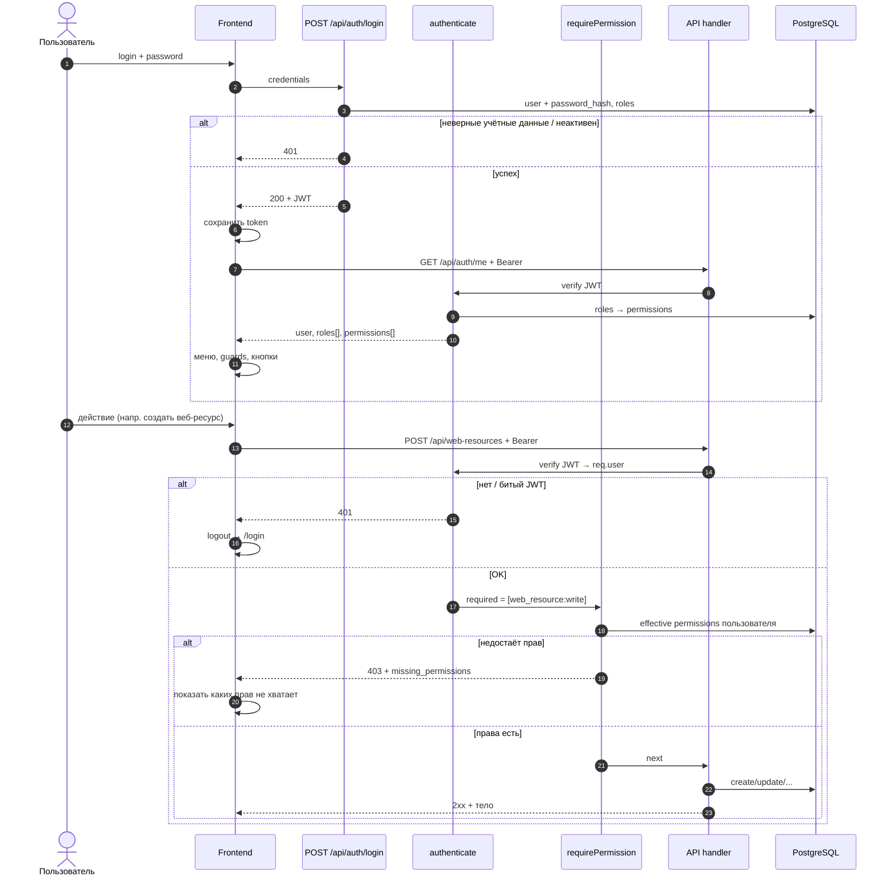

# Разграничение прав доступа в ИСАР

**Статус:** **реализация в коде (#66)** — локальный login/JWT, таблицы RBAC, middleware, UI login + администрирование; default `AUTH_ENABLED=false` (open mode).  
**Версия:** 0.3.16  
**GitHub:** https://github.com/dgabadulin/ArchRep/issues/66  
**Связанные материалы:** `docs/settings-parameters-design.md` (параметры; префикс SSO — `SEC_`), `docs/data-import-service.md`, `docs/web-resource-registry-schema.md`, `docs/domain-registry-schema.md` (#67, `domain:*`), `frontend-v3/src/config/menu.js`, `frontend-v3/src/router/index.js`, `.env.example` (`AUTH_ENABLED`, bootstrap)

**Изменения 0.3:** локальная авторизация как первый этап; 4 роли (без DOMAIN_LEAD); упрощение permissions ADRA; веб-ресурсы и сервисный импорт; модель данных без audit log и без кода группы у permission. Выключатель авторизации — **env `AUTH_ENABLED`**, не `ar_parameters`. Обязательные пользователи `demo` и `aradmin` — bootstrap из env. **Фаза B (Keycloak)** — договорена, в коде **не реализована** (см. §3.1).

---

## 1. Цели и границы

| Цель | Описание |
|------|----------|
| **Идентификация** | Кто вошёл в систему и от чьего имени идут изменения. |
| **Конфиденциальность** | Ограничение чтения чувствительных разделов (заключения, долги, секретные параметры). |
| **Целостность** | Запрет административных и массовых операций без роли. |
| **Согласованность с TOGAF** | Права по доменам: Governance, Business, Application, Technology, Analytics, Settings. |

**Вне первой очереди:** построчный ABAC по OU/владельцу ИС, роль DOMAIN_LEAD / scope OU, workflow согласования ADR, делегирование прав, роли из **групп** Keycloak (этап 2 §3.1), audit log в БД.  
**Фаза B SSO (этап 1):** BFF OIDC + JIT VIEWER — в коде; см. §3.1.
**Второй этап после внедрения SSO (явно не в первой поставке KC):** назначение / синхронизация ролей ИСАР из **групп Keycloak** (сейчас роли только в БД).

---

## 2. Текущее состояние (as-is)

| Аспект | Состояние |
|--------|-----------|
| API | Все `GET/POST/PUT/DELETE /api/*` без проверки пользователя. |
| Учётные записи | Нет `ar_app_users`; `ar_employees` — каталог, не логин. |
| SSO | Договорённости фазы B (§3.1) зафиксированы; **в коде не реализовано**. Параметры SSO — префикс `SEC_`. |
| Админ-действия | Только `ADMIN_API_RESTART_SECRET` / `ALLOW_INSECURE_RESTART_WITHOUT_SECRET` для restart Node. |
| RBAC в коде | Не реализован. |

---

## 3. Целевая модель

### 3.1. Аутентификация: сначала локальная, затем Keycloak

#### Выключатель: `AUTH_ENABLED` (env)

| Значение | Поведение |
|----------|-----------|
| `true` / `1` / `yes` | Авторизация **включена**: без JWT → 401; UI показывает `/login`; RBAC активен |
| `false` / `0` / `no` / **не задано** | Авторизация **выключена** (open mode): JWT не требуется; форма логина **не показывается**; API и UI как с полными правами |

\* **Default при отсутствии переменной: `false`** (open mode). На prod при необходимости защиты задавать явно `AUTH_ENABLED=true` в `.env.production`.

| Open mode (`AUTH_ENABLED=false`) | Деталь |
|----------------------------------|--------|
| Токен | **Не используется**: не выдавать, на фронте не хранить; устаревший JWT игнорировать/удалить |
| `GET /api/auth/me` | Без Bearer: `{ auth_enabled: false, user: { login: "anonymous", … }, roles: ["OPEN_ACCESS"], permissions: […все…] }` или `permissions: ["*"]` |
| `requirePermission` | Всегда пропускает |
| `POST /api/auth/login` | `400` — авторизация отключена (или не регистрировать route) |
| UI | Нет редиректа на `/login`; boot → `me`/`config` → сразу приложение |
| `GET /api/config` | Публично отдаёт `auth_enabled: false\|true` (из env), чтобы фронт знал режим до/вместе с `me` |

Флаг **только в env** (не в `ar_parameters`): нельзя выключить защиту из UI скомпрометированным админом; смена — перезапуск процесса API (как и прочие env).

#### Обязательные пользователи (bootstrap)

При развёртывании схемы auth / первом старте API **обязательно** создать двух пользователей с полным набором прав (роль `SYSTEM_ADMIN` или эквивалент «все permissions»):

| login | Назначение |
|-------|------------|
| `demo` | Демонстрационный вход с полным доступом |
| `aradmin` | Администратор репозитория/платформы |

**Где создаются (нет отдельного SQL-скрипта):**

| Что | Где |
|-----|-----|
| Bootstrap `demo` / `aradmin` | Код **`backend/auth/bootstrapAuth.js`**, вызывается при старте API из `backend/index.js` (после миграций и `loadParams`) |
| Матрица ролей → permissions | Тот же bootstrap (`ensureRolesAndPermissions`) + сиды permissions/ролей в dual-миграции `DB/scripts/migrate_20260807120000_rbac_auth_tables.sql` |
| Остальные пользователи | UI **Администрирование → Пользователи** / API `POST /api/admin/users` (нужны `users:write`, роли — `roles:assign`) |

Plaintext паролей в SQL-миграциях и в git **не допускается** — поэтому bootstrap не вынесен в `DB/scripts/*.sql`, а выполняется в runtime из env.

Правила:

- В БД хранится только **`password_hash`** (в текущей реализации — **scrypt**, формат `scrypt$N$r$p$salt$hash`).
- Пароли задаются **только через env** на стенде (см. таблицу переменных ниже).
- Создание **идемпотентное**: если пользователь с таким `login` уже есть — не дублировать; **роли не менять и не добавлять** (в т.ч. не возвращать снятый `SYSTEM_ADMIN`); hash обновлять только при `AUTH_BOOTSTRAP_RESET_PASSWORDS=true`.
- Роль `SYSTEM_ADMIN` назначается **только при первом создании** `demo` / `aradmin`.
- Если соответствующий `*_PASSWORD` в env **не задан** — пользователя с этим login **не создавать** (или не менять пароль): bootstrap не должен падать в CI без секретов.
- Флаг `must_change_password` при создании bootstrap-пользователей задаётся **из env** (`AUTH_BOOTSTRAP_MUST_CHANGE_PASSWORD`).

| Переменная env | Смысл |
|----------------|--------|
| `AUTH_ENABLED` | Вкл/выкл авторизации; default если не задан — `false` |
| `JWT_SECRET` | Секрет подписи локального JWT (обязателен при `AUTH_ENABLED=true`); пример длины — ≥32 байт случайных данных (Base64) |
| `AUTH_BOOTSTRAP_DEMO_PASSWORD` | Plaintext пароль для login `demo` → hash при bootstrap |
| `AUTH_BOOTSTRAP_ARADMIN_PASSWORD` | Plaintext пароль для login `aradmin` → hash при bootstrap |
| `AUTH_BOOTSTRAP_RESET_PASSWORDS` | `true` — перезаписать hash существующих `demo`/`aradmin` из env при старте/bootstrap (осторожно на prod) |
| `AUTH_BOOTSTRAP_MUST_CHANGE_PASSWORD` | `true`/`false` — значение `must_change_password` для создаваемых bootstrap-пользователей |

Куда класть env на стендах:

| Стенд / скрипт | Файл |
|----------------|------|
| Demo (`deploy_demo_api` / `deploy_demo_full`) | **`infra/demo/env.demo`** |
| Prod-скрипт (`deploy_local` → `infra/prod/deploy.bat`) | **`.env.production`** в корне репозитория |
| Шаблон без секретов | **`.env.example`**, **`infra/demo/env.demo.example`** |

**Фаза A (сейчас, #66) — локальная авторизация в БД ИСАР** (при `AUTH_ENABLED=true`)

| Элемент | Решение |
|---------|---------|
| Хранение учёток | `ar_app_users` (login, password_hash, …) |
| Вход | `POST /api/auth/login` (login + password) → JWT Bearer (issuer приложения) |
| Управление | UI/API: создание пользователей, сброс/смена пароля, назначение ролей |
| Bootstrap | Обязательные `demo` и `aradmin` (SYSTEM_ADMIN) из env — см. выше |
| Keycloak | Не требуется |

**Фаза B — Keycloak (OIDC) — согласовано; BFF + JIT VIEWER в коде (этап 2 групп — нет)**

Корпоративный SSO: realm `common`, IdP `https://sso.example.com/`. Клиент **confidential** `app.example.com` (secret **только на backend** / env / secret store; не в git и не на фронт).  
Discovery: `https://sso.example.com/realms/common/.well-known/openid-configuration` (issuer, authorize, token, userinfo, jwks, logout).

| Элемент | Решение |
|---------|---------|
| Включение SSO | Системный параметр **`SEC_KEYCLOAK_ENABLED`**; client id/secret, redirect — **env** (см. таблицу констант ниже) |
| Режим UI входа | Параметр **`SEC_KEYCLOAK_LOGIN_MODE`**: `button` \| `auto` \| `silent` (см. ниже) |
| OIDC flow | Authorization Code на **backend** (BFF): redirect → KC → callback API с `code` → обмен code+`client_secret` на tokens |
| PKCE | Поддерживается IdP (S256); при confidential-клиенте секрет всё равно только на сервере |
| Чужие access token | **Не принимаем** (токен другого client realm). «Уже залогинен в других сервисах» = живая **SSO-сессия KC**; для ИСАР — короткий code flow своего клиента (без повторного пароля) |
| После успеха | Backend выдаёт **локальный JWT ИСАР** (как фаза A); дальше `/api/*` и RBAC без изменения модели |
| Профиль | Сначала **ID Token** (`sub`, `email`, `preferred_username`, `name`…); **UserInfo** — если в токене не хватает полей |
| Связка учётки | 1) `keycloak_sub`; 2) иначе уникальный `email` → привязать `sub`; 3) иначе JIT |
| Провижининг | **JIT:** при первом успешном SSO создать `ar_app_users` с ролью **`VIEWER`**, `auth_provider=keycloak`, без локального пароля. Повторный вход роли **не сбрасывает** |
| Роли (этап 1 SSO) | **Источник истины — БД** (`ar_user_roles`). Админ повышает права вручную. KC даёт только identity |
| Break-glass | Локальный login `demo`/`aradmin` сохраняется. При `SEC_KEYCLOAK_LOGIN_MODE=auto` обязателен обход, напр. `/login?local=1` без auto-redirect |
| Redirect URI | Valid Redirect URI в KC → **backend** callback, напр. `https://<хост-ИСАР>/api/auth/oidc/callback` (отдельно demo/test/prod) |

##### `SEC_KEYCLOAK_LOGIN_MODE`

| Значение | Поведение |
|----------|-----------|
| `button` | На `/login` кнопка «Войти через SSO» (явный старт OIDC) |
| `auto` | Нет локального JWT → сразу redirect на OIDC login (удобно при корпоративной SSO-сессии) |
| `silent` | Сначала тихий SSO (`prompt=none`); нет сессии KC → страница логина (локальный + кнопка SSO) |

Публично (без секрета) отдавать во фронт через `GET /api/config`: `keycloak_enabled`, `keycloak_login_mode`.

##### Где фиксируются константы для работы с KC

Имена параметров — **КАПС** (`SEC_KEYCLOAK_*`). Секреты в БД/UI не хранятся.

| Константа | Где задаётся | Пример / как получается |
|-----------|--------------|-------------------------|
| Вкл. SSO | параметр БД **`SEC_KEYCLOAK_ENABLED`** (UI «Параметры») | `true` / `false` |
| Режим UI входа | параметр БД **`SEC_KEYCLOAK_LOGIN_MODE`** | `button` \| `auto` \| `silent` |
| Issuer (realm URL) | параметр БД **`SEC_KEYCLOAK_ISSUER`** и/или env `KEYCLOAK_ISSUER` (env имеет приоритет) | `https://sso.example.com/realms/common` |
| URL discovery (openid-configuration) | **не хранить отдельно** — собирается: `{issuer}/.well-known/openid-configuration` | …/realms/common/.well-known/openid-configuration |
| authorize / token / userinfo / jwks / logout | **не хардкодить** — читать из discovery при старте API (кэш) | из JSON discovery |
| Client ID | **env** `KEYCLOAK_CLIENT_ID` (секретный контур стенда) | `app.example.com` |
| Client secret | **только env** `KEYCLOAK_CLIENT_SECRET` | не в git, не в `ar_settings_parameters` |
| Redirect URI (наш callback) | **env** `KEYCLOAK_REDIRECT_URI` (должен совпасть с Valid Redirect URI в KC) | `https://<хост>/api/auth/oidc/callback` |
| Public base URL приложения (для сборки redirect, если нужно) | env / уже существующие настройки стенда | — |

Приоритет чтения при реализации (как у прочих параметров): **env > значение в БД (`SEC_*`) > default в коде**.  
В коде допустимы только **имена ключей** (константы строк `SEC_KEYCLOAK_ENABLED`, `KEYCLOAK_CLIENT_ID`, …), не URL/secret стенда.

##### Этап 2 после внедрения SSO (**не реализовано**, отдельная задача)

Переделать **назначение ролей** в зависимости от **групп Keycloak** (маппинг group → роль(и) ИСАР, синхронизация при логине и/или по расписанию).  
До реализации этапа 2: JIT только `VIEWER`; изменение ролей — только UI/API администрирования ИСАР. Группы KC на права **не влияют**.

Связь с каталогом сотрудников (опционально): `ar_app_users.employee_id` → `ar_employees`.

### 3.2. Авторизация (RBAC)

```
Пользователь → Роль(и) → Permission(ы)
```

Effective permissions = объединение permissions всех назначенных ролей.

**Permission:** `<resource>:<action>`

| Действие | Смысл |
|----------|--------|
| `read` | Просмотр списков и карточек, GET API |
| `write` | Создание и изменение (POST, PUT), включая вложенные операции сущности |
| `delete` | Удаление (DELETE) |
| `export` | Выгрузка Excel (`?excel=1` и сервисный экспорт шаблона импорта) |
| `execute` | Сервисные/административные операции без CRUD сущности |

### 3.3. Роли (только эти четыре)

| Код | Название | Назначение |
|-----|----------|------------|
| `VIEWER` | Наблюдатель | Чтение каталогов, аналитика, дашборды, экспорт где разрешён |
| `ARCHITECT` | Архитектор | CRUD доменных реестров, ADR, интеграции, диаграммы, связи метамодели |
| `REPOSITORY_ADMIN` | Администратор репозитория | Как ARCHITECT + параметры, справочники, сервисные операции, пересборка, пользователи/роли |
| `SYSTEM_ADMIN` | Администратор платформы | **Весь каталог permissions** (при старте API матрица роли пересобирается из `permissionsCatalog.js`) |

Роли системные (`is_system`): коды фиксированы, удалять нельзя; матрица permission сидится миграциями.

### 3.4. Упрощение ADRA

Отдельные `adr_applied:diagram:edit` и `adr_applied:increment:write` **не используются**.

| Permission | Покрывает |
|------------|-----------|
| `adr_applied:read` / `export` | Просмотр и выгрузка |
| `adr_applied:write` | Шапка заключения **и** инкременты, системы/связи/функции, сохранение схем Draw.io |
| `adr_applied:delete` | Удаление заключения |

---

## 4. Каталог permissions

### 4.1. Governance

| Permission | Ресурс |
|------------|--------|
| `principle:read` / `write` / `delete` / `export` | `ar_principles` |
| `adr_principle:read` / `write` / `delete` / `export` | `ar_adrs_principle` |
| `adr_applied:read` / `write` / `delete` / `export` | `ar_adrs_applied` (+ инкременты, диаграммы) |
| `gap:read` / `write` / `delete` / `export` | `ar_gaps` |

### 4.2. Business

| Permission | Ресурс |
|------------|--------|
| `organization_unit:read` / `write` / `delete` / `export` | Орг. единицы |
| `actor:read` / `write` / `delete` / `export` | Заинтересованные лица |
| `business_service:read` / `write` / `delete` / `export` | Продукты (бизнес-сервисы) |
| `business_function:read` / `write` / `delete` / `export` | Бизнес-способности |
| `goals:read` | Цели и задачи (placeholder) |

### 4.3. Application

| Permission | Ресурс |
|------------|--------|
| `system:read` / `write` / `delete` / `export` | Каталог ИС и модулей |
| `system_function:read` / `write` / `delete` | Функции ИС |
| `integration_flow:read` / `write` / `delete` / `export` | Реестр интеграций |
| `web_resource:read` / `write` / `delete` / `export` | Реестр веб-ресурсов |
| `domain:read` / `write` / `delete` / `export` | Реестр доменов (#67) |
| `partner:read` / `write` / `delete` / `export` | Контрагенты |
| `employee:read` / `write` / `delete` / `export` | Сотрудники (каталог) |
| `infrastructure:read` | Каталог инфраструктуры из Netbox (read-only, #92) |

### 4.4. Technology

| Permission | Ресурс |
|------------|--------|
| `technology:read` / `write` / `delete` / `export` | Каталог технологий |
| `tech_radar:read` | Страница iframe «Тех.радар» |

### 4.5. Analytics

| Permission | Ресурс |
|------------|--------|
| `analytics:read` | Анализ зависимостей |
| `dashboard:read` | Дашборды и home-stats |
| `metamodel_relation:read` / `write` / `delete` / `export` | Ручные связи метамодели |
| `metamodel:rebuild` | Пересборка проекций интеграционных потоков |

### 4.6. Settings и администрирование

| Permission | Ресурс |
|------------|--------|
| `references:read` / `write` | Справочники (включая справочники веб-ресурсов) |
| `metamodel_catalog:read` / `write` | Типы сущностей/связей метамодели |
| `settings_parameters:read` / `write` | Системные параметры |
| `service_operations:execute` | Сервисные операции UI (пересборка и пр., **кроме** импорта данных) |
| `import:execute` | Сервисный импорт Excel: экран `/settings/service-operations/import` и `/api/import/*` |
| `users:read` | Список и карточка учётных записей (`ar_app_users`) |
| `users:write` | Создание/изменение пользователя, активность, сброс пароля админом, `must_change_password` |
| `users:delete` | Удаление учётной записи (кроме запрета удалить себя / последнего SYSTEM_ADMIN — правило реализации) |
| `users:export` | Выгрузка списка пользователей в Excel |
| `roles:read` | Справочник ролей и просмотр матрицы роль→permission |
| `roles:assign` | Назначение и снятие ролей пользователю (`ar_user_roles`) |
| `roles:write` | Изменение названия/описания роли и состава `ar_role_permissions` |
| `system_admin:restart` | Перезапуск процесса API |

Импорт Excel: доступ к экрану и API — **`import:execute`**. На `apply` дополнительно требуется `<resource>:write` целевого реестра (например `web_resource:write`). Выгрузка из списка реестра — `<resource>:export`; шаблон/экспорт из формы импорта — `import:execute`.

Редактирование состава permissions у ролей (`ar_role_permissions`) — в UI через экран роли (`roles:write`). Сиды/миграции и bootstrap по-прежнему задают исходную матрицу.

Смена **своего** пароля (залогиненным пользователем) — без `users:write`; отдельный endpoint после auth.

### 4.7. Публичные endpoint (без JWT)

| Endpoint | Примечание |
|----------|------------|
| `GET /api/health`, `GET /api/health/db` | Мониторинг |
| `POST /api/auth/login` | Локальный вход (если `AUTH_ENABLED`) |
| `GET /api/config` | **Всегда публичный**; включает `auth_enabled` (из env), без секретов |

---

## 5. Матрица «роль × permission»

Обозначения: **R** = read, **W** = write, **D** = delete, **E** = export, **X** = execute / спец., **A** = assign, **—** = нет.

| Permission | VIEWER | ARCHITECT | REPOSITORY_ADMIN | SYSTEM_ADMIN |
|------------|:------:|:---------:|:----------------:|:------------:|
| **Governance** |
| `principle:*` | R,E | R,W,D,E | R,W,D,E | R,W,D,E |
| `adr_principle:*` | R,E | R,W,D,E | R,W,D,E | R,W,D,E |
| `adr_applied:read`, `export` | R,E | R,E | R,E | R,E |
| `adr_applied:write`, `delete` | — | W,D | W,D | W,D |
| `gap:*` | R,E | R,W,D,E | R,W,D,E | R,W,D,E |
| **Business** |
| `organization_unit:*` | R,E | R,W,D,E | R,W,D,E | R,W,D,E |
| `actor:*` | R,E | R,W,D,E | R,W,D,E | R,W,D,E |
| `business_service:*` | R,E | R,W,D,E | R,W,D,E | R,W,D,E |
| `business_function:*` | R,E | R,W,D,E | R,W,D,E | R,W,D,E |
| `goals:read` | R | R | R | R |
| **Application** |
| `system:*` | R,E | R,W,D,E | R,W,D,E | R,W,D,E |
| `system_function:*` | R | R,W,D | R,W,D | R,W,D |
| `integration_flow:*` | R,E | R,W,D,E | R,W,D,E | R,W,D,E |
| `web_resource:*` | R,E | R,W,D,E | R,W,D,E | R,W,D,E |
| `domain:*` | R,E | R,W,D,E | R,W,D,E | R,W,D,E |
| `partner:*` | R,E | R,W,D,E | R,W,D,E | R,W,D,E |
| `employee:*` | R,E | R,W,D,E | R,W,D,E | R,W,D,E |
| **Technology** |
| `technology:*` | R,E | R,W,D,E | R,W,D,E | R,W,D,E |
| `tech_radar:read` | R | R | R | R |
| **Analytics** |
| `analytics:read` | R | R | R | R |
| `dashboard:read` | R | R | R | R |
| `metamodel_relation:*` | R,E | R,W,D,E | R,W,D,E | R,W,D,E |
| `metamodel:rebuild` | — | — | X | X |
| **Settings / admin** |
| `references:read` | R | R | R,W | R,W |
| `references:write` | — | — | W | W |
| `metamodel_catalog:read` | R | R | R,W | R,W |
| `metamodel_catalog:write` | — | — | W | W |
| `settings_parameters:read` | — | — | R | R |
| `settings_parameters:write` | — | — | W | W |
| `service_operations:execute` | — | — | X | X |
| `import:execute` | — | — | X | X |
| `users:read` | — | — | R | R |
| `users:write` | — | — | W | W |
| `users:delete` | — | — | D | D |
| `users:export` | — | — | E | E |
| `roles:read` | — | — | R | R |
| `roles:assign` | — | — | A | A |
| `roles:write` | — | — | W | W |
| `system_admin:restart` | — | — | — | X |

---

## 6. Матрица «меню и маршруты UI × permission»

| № | Раздел меню | Путь | Просмотр | Создание / правка | Удаление | Доп. |
|---|-------------|------|:--------:|:-----------------:|:--------:|------|
| | **Главная** |
| 1 | — | `/` | `dashboard:read` | — | — | |
| | **Управление архитектурой** |
| 2 | Архитектурные принципы | `/principles` | `principle:read` | `principle:write` | `principle:delete` | export → `principle:export` |
| 3–4 | ADR | `/decisions/principle` (+ new/edit) | `adr_principle:read` | `adr_principle:write` | `adr_principle:delete` | |
| 5–7 | Архитектурные заключения + схема | `/decisions/applied`, diagram-editor | `adr_applied:read` | `adr_applied:write` | `adr_applied:delete` | схема/инкременты = `write` |
| 8–9 | Архитектурный долг | `/architecture-debt` (+ new/edit) | `gap:read` | `gap:write` | `gap:delete` | |
| | **Бизнес-архитектура** |
| 10 | Орг. единицы | `/organization-units` | `organization_unit:read` | `organization_unit:write` | `organization_unit:delete` | |
| 11 | Заинтересованные лица | `/actors` | `actor:read` | `actor:write` | `actor:delete` | |
| 12 | Продукты | `/business-services` | `business_service:read` | `business_service:write` | `business_service:delete` | |
| 13 | Бизнес-способности | `/business-functions` | `business_function:read` | `business_function:write` | `business_function:delete` | |
| 14 | Цели и задачи | `/goals` | `goals:read` | — | — | placeholder |
| | **Информационные системы** |
| 15 | Каталог ИС | `/systems` | `system:read` | `system:write` | `system:delete` | |
| 16 | Реестр интеграций | `/integrations` | `integration_flow:read` | `integration_flow:write` | `integration_flow:delete` | |
| 17 | Реестр веб-ресурсов | `/web-resources` (+ new/edit) | `web_resource:read` | `web_resource:write` | `web_resource:delete` | export → `web_resource:export` |
| 17a | Реестр доменов | `/domains` (+ new/edit) | `domain:read` | `domain:write` | `domain:delete` | export → `domain:export`; [#67](https://github.com/dgabadulin/ArchRep/issues/67) |
| | **Технологии** |
| 18 | Каталог технологий | `/technologies` | `technology:read` | `technology:write` | `technology:delete` | |
| 19 | Тех.радар | `/tech-radar` | `tech_radar:read` | — | — | |
| | **Инфраструктура** | | | | | |
| 19a | Каталог инфраструктуры | `/infrastructure` | `infrastructure:read` | — | — | read-only, [#92](https://github.com/dgabadulin/ArchRep/issues/92) |
| | **Аналитика** |
| 20 | Анализ зависимостей | `/analytics` | `analytics:read` | — | — | |
| 21–22 | Дашборды | `/dashboards`, `/dashboards/catalog` | `dashboard:read` | — | — | |
| 23 | Связи объектов управления | `/metamodel-relations` | `metamodel_relation:read` | `metamodel_relation:write` | `metamodel_relation:delete` | |
| | **Настройки** |
| 24 | Справочники | `/references` | `references:read` | `references:write` | `references:write` | |
| 25 | Параметры | `/settings/parameters` | `settings_parameters:read` | `settings_parameters:write` | — | |
| 26 | Сервисные операции | `/settings/service-operations` | `service_operations:execute` | — | — | |
| 26a | Импорт данных | `/settings/service-operations/import` | `import:execute` | — | — | apply → ещё `<resource>:write` |
| | **Администрирование** (отдельная группа меню, рядом с Настройками) |
| 27 | Пользователи | `/settings/administration/users` | `users:read` | `users:write` | `users:delete` | export → `users:export`; пункт меню при `users:read` |
| 28 | Роли | `/settings/administration/roles` (+ edit) | `roles:read` | `roles:write` | — | назначение ролей пользователям — `roles:assign`; правка матрицы role↔permission — `roles:write` |

Группа меню **Администрирование** (на одном уровне с **Настройки**) показывается, если есть хотя бы одно из: `users:read`, `roles:read`.

**Фронт:** `requiredPermissions` в `menu.js` / `meta` маршрута; guard `router.beforeEach`; кнопки по `write` / `delete` / `export` / `assign`.

---

## 7. Матрица «API × permission»

Для CRUD: **GET** → `read`, **POST/PUT** → `write`, **DELETE** → `delete`, **?excel=1** → `export`.

### 7.1. Auth

| API | Permission / доступ |
|-----|---------------------|
| `POST /api/auth/login` | публичный |
| `GET /api/auth/me` | любой аутентифицированный |
| `POST /api/auth/logout` | любой аутентифицированный (если есть revoke) |
| `POST /api/auth/change-password` | свой пароль; админский reset — `users:write` |

### 7.2. Governance

| API | Permission |
|-----|------------|
| `/api/principles` | `principle:*` |
| `/api/decisions/principle` | `adr_principle:*` |
| `/api/decisions/applied`, `.../full`, increments, diagrams, function-selection | `adr_applied:read` или `adr_applied:write` по методу |
| `/api/ar-gaps`, `.../relations` | `gap:*` |
| Справочники долга (`ar-gap-types`, …) | `references:*` |

### 7.3. Application

| API | Permission |
|-----|------------|
| `/api/ar-systems`, add/update | `system:*` |
| `/api/ar-systems/:id/system-functions` | `system_function:*` |
| `GET /api/integration-flows?system_id=` | **anyOf** `integration_flow:read` \| `system:read` (срез карточки ИС) |
| `/api/integration-flows` (реестр / карточка потока) | `integration_flow:*` |
| `/api/web-resources` | `web_resource:*` |
| `GET /api/togaf/domains` (список, lookup на форме WR) | **anyOf** `domain:read` \| `web_resource:write`; Excel → `domain:export` |
| `/api/togaf/domains` (карточка / мутации) | `domain:*` |
| `GET /api/partners` (список) | **anyOf** `partner:read` \| `system:read` \| `domain:write` (lookup); Excel → `partner:export` |
| `/api/partners` (карточка / мутации) | `partner:*` |
| `GET /api/ar-employees` (список) | **anyOf** `employee:read` \| `system:read` \| `domain:write` |
| `/api/ar-employees` (карточка / мутации) | `employee:*` |
| `GET /api/technologies` (список) | **anyOf** `technology:read` \| `system:read` |
| `GET/POST/DELETE /api/systems-technologies` | `system:read` / `system:write` (связь на карточке ИС) |

См. §10.6 (реестр ≠ lookup, вкладки-срезы карточки).

### 7.4. Technology / Business / Metamodel

| API | Permission |
|-----|------------|
| `/api/technologies` | `technology:*` |
| `/api/togaf/organization-units` | `organization_unit:*` |
| `/api/togaf/actors` | `actor:*` |
| `/api/togaf/business-services` | `business_service:*` |
| `/api/togaf/business-functions` | `business_function:*` |
| `/api/togaf/relations` | `metamodel_relation:*` |
| `/api/togaf/entity-types`, `relation-types` | `metamodel_catalog:*` |
| `GET /api/infrastructure` | `infrastructure:read` (read-only, #92) |
| `/api/togaf/refs/infrastructure-object-types` | `references:*` |
| `POST .../rebuild-integration-flow-projections` | `metamodel:rebuild` |
| `GET /api/dashboard/home-stats` | `dashboard:read` |

### 7.5. Settings, import, users

| API | Permission |
|-----|------------|
| `/api/settings-parameters` | `settings_parameters:*` |
| Справочники статусов/типов (в т.ч. web-resource refs) | `references:*` (read для форм — мягко при любом `*:write` домена) |
| `/api/import/entities`, `template`, `export`, `validate`, `apply` | `import:execute`; apply также требует `<entity>:write` |
| `/api/users` GET list/get | `users:read` |
| `/api/users` POST/PUT, reset-password, activate | `users:write` |
| `/api/users` DELETE | `users:delete` |
| `/api/users/:id/roles` GET | `roles:read` или `users:read` |
| `/api/users/:id/roles` PUT/PATCH (назначение) | `roles:assign` |
| `/api/roles` GET (список + permissions роли) | `roles:read` |
| `/api/admin/restart-node` | `system_admin:restart` (+ опционально секрет break-glass) |

---

## 8. Матрица «действия UI × permission»

| Действие в UI | Permission |
|---------------|------------|
| Открыть список / карточку | `<resource>:read` |
| Создать / Сохранить | `<resource>:write` |
| Удалить | `<resource>:delete` |
| Выгрузить в Excel (из списка) | `<resource>:export` |
| Вкладки-срезы на карточке ИС (стек, интеграции этой системы) | показ — `system:read`; мутации — `system:write` |
| Переход из среза в чужую карточку/реестр | право **целевой** сущности (`integration_flow:read` и т.п.) |
| FK-select (lookup) на форме | не требует `*:read` реестра связанной сущности; «+» — её `:write` |
| Редактор схемы / инкременты ADRA | `adr_applied:write` |
| Пересобрать проекции интеграций | `metamodel:rebuild` |
| Импорт данных (проверить/загрузить) | `import:execute` + на apply ещё `<resource>:write` |
| Перезапустить API | `system_admin:restart` |
| Создать / изменить пользователя, сбросить пароль | `users:write` |
| Удалить пользователя | `users:delete` |
| Выгрузить пользователей в Excel | `users:export` |
| Просмотр ролей и матрицы прав | `roles:read` |
| Назначить / снять роли пользователю | `roles:assign` |
| Изменить роль и её permissions | `roles:write` |

Детали UX и согласованность API — §10.6.

---

## 9. Модель данных

### 9.1. Где что хранится

| Компонент | Где |
|-----------|-----|
| Пользователи, пароли (hash), назначения ролей | БД (`ar_app_users`, `ar_user_roles`) |
| Роли и permissions, матрица роль→permission | БД (сиды миграциями) |
| Секреты/флаги SSO (позже) | параметры / env |
| Audit log | **не в объёме** этой версии спеки |

### 9.2. Таблицы

```sql
-- Учётная запись приложения (не ar_employees)
ar_app_users (
  id                bigserial PRIMARY KEY,
  login             varchar(100) NOT NULL UNIQUE,
  email             varchar(255) NULL UNIQUE,
  display_name      varchar(255) NOT NULL,
  password_hash     text NULL,              -- NULL допустим после перехода на SSO-only
  auth_provider     varchar(20) NOT NULL DEFAULT 'local',  -- local | keycloak | hybrid
  keycloak_sub      varchar(100) NULL UNIQUE,
  employee_id       bigint NULL REFERENCES archrep.ar_employees(id),
  is_active         boolean NOT NULL DEFAULT true,
  must_change_password boolean NOT NULL DEFAULT false,
  last_login_at     timestamptz NULL,
  created_at        timestamptz NOT NULL DEFAULT now(),
  updated_at        timestamptz NOT NULL DEFAULT now(),
  created_by_user_id bigint NULL REFERENCES archrep.ar_app_users(id)
);

ar_roles (
  id          bigserial PRIMARY KEY,
  code        varchar(64) NOT NULL UNIQUE,  -- VIEWER, ARCHITECT, ...
  name        varchar(255) NOT NULL,
  description text NULL,
  is_system   boolean NOT NULL DEFAULT true,
  is_active   boolean NOT NULL DEFAULT true
);

ar_permissions (
  id          bigserial PRIMARY KEY,
  code        varchar(128) NOT NULL UNIQUE, -- например web_resource:write
  description text NULL,
  is_active   boolean NOT NULL DEFAULT true
);

ar_role_permissions (
  role_id       bigint NOT NULL REFERENCES archrep.ar_roles(id) ON DELETE CASCADE,
  permission_id bigint NOT NULL REFERENCES archrep.ar_permissions(id) ON DELETE CASCADE,
  PRIMARY KEY (role_id, permission_id)
);

ar_user_roles (
  user_id            bigint NOT NULL REFERENCES archrep.ar_app_users(id) ON DELETE CASCADE,
  role_id            bigint NOT NULL REFERENCES archrep.ar_roles(id) ON DELETE CASCADE,
  assigned_at        timestamptz NOT NULL DEFAULT now(),
  assigned_by_user_id bigint NULL REFERENCES archrep.ar_app_users(id),
  PRIMARY KEY (user_id, role_id)
);
```

Опционально позже (не обязательно в фазе A): `ar_auth_sessions` для refresh/revoke.

### 9.3. Endpoint идентификации

`GET /api/auth/me` → `{ user, roles[], permissions[] }` — для меню и кнопок после логина.

---

## 10. Реализация проверок

### 10.1. Backend

1. `POST /api/auth/login` — проверка hash, выдача JWT (sub = `ar_app_users.id`, claims: login, roles или только sub + загрузка прав на каждый запрос/кэш).
2. Middleware `authenticate` — Bearer JWT → `req.user`. Нет/невалидный токен → **401**.
3. `requirePermission(...)` — проверка effective permissions из ролей. Не хватает прав → **403** (см. §10.4).
4. По умолчанию **deny** для `/api/*`, кроме whitelist: health, login, публичный config.

`requirePermission` / маппинг маршрутов принимает один код или список (AND): например импорт apply — `['import:execute', 'web_resource:write']`. Для lookup и срезов карточки — `anyOf` (достаточно одного кода). В ответе 403 перечисляются **недостающие** (для anyOf — весь список кандидатов и `required_mode: "anyOf"`).

> **Новый API-маршрут обязательно регистрировать в `routePermissions.js`** — иначе сработает deny-by-default (403 у всех ролей, включая `SYSTEM_ADMIN`). Пошаговый чек-лист: [adding-new-api-endpoint.md](./adding-new-api-endpoint.md).

### 10.2. Frontend

1. Экран логина; access token в **`sessionStorage`**; все API-вызовы с `Authorization: Bearer …`.
2. После входа (и при F5 при живом токене) — `GET /api/auth/me` → store `{ user, roles, permissions }`.
3. Фильтрация `menu.js`; `router.beforeEach` по `meta.requiredPermissions`; `v-if` на кнопках.
4. Глобальный обработчик ошибок API: **401** → очистить сессию и `/login`; **403** → показать сообщение с `missing_permissions` (и при желании полный `required_permissions`).

Фронт — UX-слой; отказ всегда подтверждается backend.

```mermaid
flowchart TD
  A[Открыли приложение] --> Z{auth_enabled из config/me?}
  Z -->|нет / false| D2[GET /api/auth/me без токена]
  D2 --> E[permissions в store — все]
  E --> F[Построить меню]
  E --> G[router.beforeEach]
  E --> H[v-if на кнопках]
  G --> J[Страница]
  Z -->|true| B{Есть JWT?}
  B -->|нет| C[/login]
  B -->|да| D[GET /api/auth/me + Bearer]
  D -->|401 / ошибка| C
  D --> E
  G -->|нет права на route| I[/forbidden]
  G -->|ок| J
```

### 10.3. Диаграмма последовательности



### 10.4. Ответ 403 с конкретными permissions

**Да — корректно и рекомендуется.** Middleware знает список *required* для route/действия и множество *effective* пользователя; разница = `missing_permissions`.

Единый контракт тела при отказе в авторизации (после успешной аутентификации):

```http
HTTP/1.1 403 Forbidden
Content-Type: application/json
```

```json
{
  "error": "forbidden",
  "message": "Недостаточно прав для выполнения операции",
  "required_permissions": ["import:execute", "web_resource:write"],
  "missing_permissions": ["web_resource:write"]
}
```

| Поле | Смысл |
|------|--------|
| `required_permissions` | Все коды, которые требовались для этого запроса (AND) |
| `missing_permissions` | Подмножество required, которых нет у пользователя |
| `message` | Человекочитаемый текст; фронт может дополнить списком кодов или их подписями из справочника |

Правила:

- **401** — не аутентифицирован (нет смысла отдавать missing permissions).
- **403** — аутентифицирован, но не авторизован; `missing_permissions` всегда непустой массив.
- Не включать в ответ полный список прав пользователя (лишнее раскрытие); достаточно required/missing.
- Для UI: тост/баннер вида «Не хватает: веб-ресурсы — изменение (`web_resource:write`)»; маппинг code→подпись можно держать на фронте рядом с каталогом permissions или отдать лёгкий словарь в `/api/auth/me`.

Пример: у пользователя есть `import:execute`, нет `web_resource:write` → apply импорта веб-ресурсов → `missing_permissions: ["web_resource:write"]`.

### 10.5. Draw.io

- Embed может быть без auth на уровне nginx.
- **Сохранение** mxfile — только API с JWT и `adr_applied:write`; отказ — тот же контракт 403.

### 10.6. UI-конвенции RBAC

Эталон — `SystemsList` / `SystemForm`. **Раскатано** на доменные списки/формы (ИС, интеграции, веб-ресурсы, технологии, ADRA/ADR, долг, бизнес-сущности, связи метамодели, принципы), справочники (`ReferencesV2`: `references` / `partner` / `employee` / `metamodel_catalog`) и параметры (`settings_parameters`).

1. **Форма = основной ресурс.** Нет `<host>:write` → режим просмотра: баннер + disabled полей; создание новой записи недоступно без write.
2. **Скрывать мутации заранее** (`v-if` на «Добавить», «Сохранить», «Удалить», «+»), а не полагаться на UX после 403.
3. **403 — запасной контур.** Текст на русском с кодом(ами) разрешения; шаблон уже в middleware / `apiErrors`.
4. **Права в shared-компонентах**, не хардкод на каждой форме (пример: `PartnerSelectField` сам решает показ «+» по `partner:write`).
5. **Реестр ≠ lookup.** Нет `partner:read` → пункт меню и маршрут реестра партнёров скрыты; FK-select на форме системы при этом работает. Быстрое создание («+») требует `partner:write`.
6. **Вкладки-срезы текущей сущности** (техстек, интеграции **этой** системы) — часть карточки хоста: показ при `system:read`, мутации при `system:write`. Не прятать из‑за отсутствия `technology:read` / `integration_flow:read`.
7. **Ссылки в чужую карточку/реестр** — по праву **цели** (например «Открыть/Изменить» поток → `integration_flow:read` / `:write`).
8. **Пункты меню реестров** по-прежнему на своём `*:read`.
9. **API согласован с UI:** срез/lookup для карточки и select не должен требовать полный `*:read` связанного реестра (в middleware — `anyOf`, см. `routePermissions.js`). Excel/полный реестр — по-прежнему свои `*:read` / `*:export`.
10. **Предпочтение hide**, а не массовый `disabled` контролов мутации.
11. **Фиксация в спеке** (этот раздел) — источник правды при раскатке на другие сущности.

Примеры API (`routePermissions.js`, `anyOf`):

| Запрос | Достаточно |
|--------|------------|
| `GET /api/integration-flows?system_id=` | `system:read` / `integration_flow:read` / `adr_applied:read` |
| `GET /api/ar-systems` (список, FK) | `system:read` или host с FK на ИС (`integration_flow`, `web_resource`, `adr_applied`, `gap`) |
| `GET /api/partners`, technologies, employees (список) | свой `*:read` или host-форма (`system` / `technology` …) |
| `GET /api/togaf/organization-units` (список) | `organization_unit:read` или `actor` / `business_service` / `business_function` / `domain:write` |
| `GET /api/togaf/domains` (список, FK на WR) | `domain:read` или `web_resource:write` |
| Справочники `GET /api/…` (типы/статусы) | `references:read` **или** read хост-формы |
| `DELETE /api/systems-technologies`, `DELETE` инкрементов ADRA | write хоста (`system:write` / `adr_applied:write`) |
| `DELETE /api/togaf/relations` с карточки gap | `gap:write` **или** `metamodel_relation:delete` |

---

## 11. Этапы внедрения

| Этап | Содержание | Критерий готовности |
|------|------------|---------------------|
| 0 | Согласование этой редакции спеки | Ок владельца продукта |
| 1 | Таблицы + сиды ролей/permissions + bootstrap admin | Можно создать пользователя в БД |
| 2 | Login / JWT / `/api/auth/me` + deny по умолчанию | Без токена API → 401 |
| 3 | UI пользователей и назначения ролей | REPOSITORY_ADMIN управляет доступом |
| 4 | RBAC на write/delete и admin-операции | Нет анонимных изменений |
| 5 | UI: меню, кнопки, guards | Нет «ложных» кнопок |
| 6 | Keycloak как identity — фаза B §3.1 этап 1 | OIDC BFF + JIT VIEWER + `SEC_KEYCLOAK_*` + login modes |
| 6b | (позже) роли из **групп Keycloak** | **Не реализовано** — отдельный этап после базового SSO |
| 7 | (позже) audit log / DOMAIN_LEAD+OU | Вне текущего объёма |

---

## 12. Решения (зафиксировано) и остаток

| # | Вопрос | Решение |
|---|--------|---------|
| 1 | Default `AUTH_ENABLED`, если не задан | **`false`** (open mode) |
| 2 | `GET /api/config` | **Да**, всегда публичный; всегда отдаёт `auth_enabled` |
| 3 | Несколько ролей на пользователя | **Да** |
| 4 | Break-glass `ADMIN_API_RESTART_SECRET` вместе с `system_admin:restart` | **Да**, оставить |
| 5 | Право на импорт | Отдельный **`import:execute`** (+ на apply ещё `<resource>:write`) |
| 6 | Где хранить JWT на фронте | **`sessionStorage`** (сессия вкладки; F5 не разлогинивает) |
| 7 | `must_change_password` для bootstrap | Задаётся **из env** `AUTH_BOOTSTRAP_MUST_CHANGE_PASSWORD` |
| 8 | Keycloak (фаза B) | Confidential client + OIDC на **backend**; локальный JWT ИСАР; JIT → **`VIEWER`**; параметры **`SEC_KEYCLOAK_*`** |
| 9 | Режим UI SSO | **`SEC_KEYCLOAK_LOGIN_MODE`**: `button` \| `auto` \| `silent` |
| 10 | Роли из групп KC | **Этап 2, не реализовано** — после базового SSO |

Также зафиксировано ранее: `AUTH_ENABLED` только env; пользователи `demo` / `aradmin`; пароли через `AUTH_BOOTSTRAP_*_PASSWORD`.

### Что нужно, чтобы начать реализацию

| # | Артефакт | Статус |
|---|----------|--------|
| 1 | Согласование v0.3.x | решения §12 закрыты |
| 2 | GitHub Issue (постановка + ссылка на этот файл) | [#66](https://github.com/dgabadulin/ArchRep/issues/66) |
| 3 | Dual-миграция таблиц + сиды ролей/permissions + bootstrap `demo`/`aradmin` | код |
| 4 | Backend: `AUTH_ENABLED`, login, JWT, `/me`, middleware, `import:execute` | код |
| 5 | Frontend: `/login` при auth on; token в `sessionStorage`; Bearer; flowchart §10.2 | код |

Этапы UI пользователей / полное покрытие write / меню — после работающего login.

---

## 13. Связь с текущими задачами

| Задача / файл | Связь с RBAC |
|---------------|--------------|
| **[#66](https://github.com/dgabadulin/ArchRep/issues/66)** — эта спека | Основная реализация: local auth, роли, middleware, UI login/users |
| `data-import-service.md` / [#64](https://github.com/dgabadulin/ArchRep/issues/64) | После RBAC: `import:execute`; apply + `<resource>:write` |
| `web-resource-registry-schema.md` | Permissions `web_resource:*` уже в каталоге §4; FK домена — [#67](https://github.com/dgabadulin/ArchRep/issues/67) |
| `domain-registry-schema.md` | Реестр доменов (#67): `domain:*`, меню `/domains`, проекция `web_resource_domain` |
| `settings-parameters-design.md` | Параметры; SSO — префикс **`SEC_`** (§3.1 фаза B); локальный auth и `AUTH_ENABLED` не зависят от KC |
| `docs/github-issue-drafts/metamodel-rebuild-rbac-ux.md` / [#36](https://github.com/dgabadulin/ArchRep/issues/36) | Endpoint rebuild → `metamodel:rebuild` (+ `service_operations:execute` для UI) |
| Demo / `.env` | `AUTH_ENABLED`; bootstrap `demo`/`aradmin`; после SYSTEM_ADMIN — убрать `ALLOW_INSECURE_RESTART_WITHOUT_SECRET` на защищённых стендах |
| `process-issue-tracking.md` | Строка `access-control-design.md` ↔ #66 |

**Администрирование доступа (в объёме #66):** UI группа **Администрирование** (рядом с Настройками): `/settings/administration/users`, `.../roles`; API — `users:read|write|delete|export`, `roles:read|assign|write`.

---

## Приложение A. Маппинг permission → сущность БД

| Permission prefix | Таблица / объект |
|-------------------|------------------|
| `system` | `ar_systems` |
| `system_function` | `ar_system_functions` |
| `technology` | `ar_technologies` |
| `integration_flow` | `ar_integration_flows` |
| `web_resource` | `ar_web_resources` |
| `domain` | `ar_domains` |
| `principle` | `ar_principles` |
| `adr_principle` | `ar_adrs_principle` |
| `adr_applied` | `ar_adrs_applied` (+ increments/diagrams) |
| `gap` | `ar_gaps` |
| `organization_unit` | `ar_organization_units` |
| `actor` | `ar_actors` |
| `business_service` | `ar_business_services` |
| `business_function` | `ar_business_functions` |
| `partner` | `ar_partners` |
| `employee` | `ar_employees` |
| `metamodel_relation` | `ar_metamodel_relations` |
| `metamodel_catalog` | `ar_metamodel_entity_types`, `ar_metamodel_relation_types` |
| `users` | `ar_app_users` |
| `roles` | `ar_roles`, `ar_user_roles` (assign); `ar_role_permissions` — только чтение/сиды |

---

## Приложение B. Пример JWT (локальный issuer)

```json
{
  "iss": "isar-local",
  "sub": "42",
  "login": "architect",
  "display_name": "Иванов И.И.",
  "roles": ["ARCHITECT"],
  "exp": 1735689600
}
```

Маппинг role → permissions — в API из БД (кэш при старте или на логин).

---

## Приложение C. История редакций

| Версия | Дата | Суть |
|--------|------|------|
| 0.2 | — | Черновик с Keycloak-first, DOMAIN_LEAD, дробные ADRA permissions, audit log |
| 0.3 | 2026-08-07 | Local-first auth; 4 роли; упрощение ADRA; `web_resource` + import; модель без audit log и без group_code у permissions |
| 0.3.1 | 2026-08-07 | §10: sequence diagram; контракт 403 с `required_permissions` / `missing_permissions` |
| 0.3.2 | 2026-08-07 | §10.2: flowchart старта приложения (JWT → me → меню/guards) |
| 0.3.3 | 2026-08-07 | Выключатель `AUTH_ENABLED` (env); open mode без логина и без JWT |
| 0.3.4 | 2026-08-07 | Обязательные пользователи `demo` / `aradmin`; пароли через `AUTH_BOOTSTRAP_*` env |
| 0.3.5 | 2026-08-07 | Решения §12: default AUTH off; config public; multi-role; break-glass; `import:execute`; must_change из env |
| 0.3.6 | 2026-08-07 | JWT на фронте: `sessionStorage`; §12 полностью закрыт |
| 0.3.7 | 2026-08-07 | §13 актуализация (#66); permissions users/roles детализированы (`users:delete`, API/UI) |
| 0.3.8 | 2026-08-07 | §6: UI RBAC в меню Настройки → Администрирование |
| 0.3.9 | 2026-08-07 | Реализация #66 в коде: dual-миграция, JWT/scrypt, middleware, login + admin UI |
| 0.3.10 | 2026-08-07 | §3.1: явно — bootstrap в `bootstrapAuth.js` (не SQL); куда класть env на demo/prod |
| 0.3.11 | 2026-08-07 | §10.6 UI-конвенции RBAC; реестр≠lookup / срезы карточки; API anyOf для пилота ИС |
| 0.3.12 | 2026-08-07 | Раскатка §10.6 на все доменные реестры + References/Settings; расширен anyOf lookup в API |
| 0.3.13 | 2026-08-07 | SYSTEM_ADMIN = полный каталог + resync при bootstrap; схемы ADRA: Open/Download в readonly, JWT во вкладке редактора |
| 0.3.14 | 2026-08-11 | §3.1 фаза B Keycloak: `SEC_KEYCLOAK_*` (КАПС), BFF OIDC, JIT VIEWER, login_mode; таблица «где константы»; этап 2 — роли из групп KC (не реализовано) |
| 0.3.15 | 2026-08-11 | Реализация фазы B этап 1: OIDC BFF (`/api/auth/oidc/*`), JIT VIEWER, сиды `SEC_KEYCLOAK_*`, UI button/auto/silent + `/login?local=1` |
| 0.3.16 | 2026-08-13 | #67 реестр доменов: `domain:*` в каталоге/матрицах/меню/API; anyOf lookup; ссылка на `domain-registry-schema.md` |
