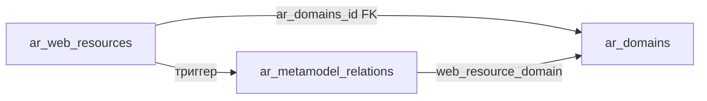

# Реестр доменов — спецификация

Документ фиксирует согласованную модель данных, метамодель, проекции связей, CRUD, UI и порядок внедрения реестра **доменов** в ИСАР.

**GitHub:** https://github.com/dgabadulin/ArchRep/issues/67

**Связанные материалы:** [web-resource-registry-schema.md](./web-resource-registry-schema.md) (FK «Домен» на веб-ресурсе), [access-control-design.md](./access-control-design.md) (#66, permissions `domain:*`), [job-runner-design.md](./job-runner-design.md) (проверка сроков доменов, планировщик), [adding-new-entity-type.md](./adding-new-entity-type.md), [demo-full-model-entities-matrix.md](./demo-full-model-entities-matrix.md), dual-миграции (`.cursor/rules/db-migrations-dual.mdc`).

---

## 1. Назначение

Реестр учитывает **домены второго уровня** (и host с одной точкой), связанные с публикациями в сети Интернет:

- хранит атрибуты регистрации и владения (регистратор, даты, статус, компания, владелец от бизнеса);
- связывается с **веб-ресурсами** через FK `ar_web_resources.ar_domains_id`;
- автоматически порождает проекцию метамодели **«Размещен»** (`web_resource → domain`);
- участвует в **анализаторе зависимостей** с первого релиза.

**Вне scope этого issue (#67):** периодическая проверка срока истечения, email-уведомления и Job Runner — см. **[job-runner-design.md](./job-runner-design.md)** (отдельная задача).

---

## 2. Согласованные решения

| № | Вопрос | Решение |
|---|--------|---------|
| 1 | Категория ОЕ «Организация» | Сид в `ar_organization_unit_categories`: `code = org`, `name = Организация` |
| 2 | Связь с веб-ресурсом | **FK** `ar_web_resources.ar_domains_id` + **триггер-проекция** «Размещен» |
| 3 | Направление связи | `web_resource → domain`, код типа `web_resource_domain`, имя «Размещен» |
| 4 | Извлечение домена из URL | См. §8; снятие `www.`; при одной точке — host целиком |
| 5 | Статус при автосоздании | **«Делегирован»** (`delegated`) — новый статус справочника |
| 6 | Массовое наполнение | **Разовая** сервисная операция; на каждый save WR домен **не** автосоздаётся |
| 7 | Валидация URL ↔ FK на save WR | Вариант **A**: при указанном FK и URL — если извлечённый домен ≠ `ar_domains.name` → **HTTP 400**, не сохранять |
| 8 | Смена FK «Домен» | Триггер пересобирает проекцию (как у других FK-проекций) |
| 9 | Уникальность | `lower(trim(name))` уникален |
| 10 | Анализатор | Тип сущности `domain` — **сразу** |
| 11 | Компания | FK на `ar_organization_units`; в UI только ОЕ с `category.code = org` |
| 12 | Multi-part TLD (`.co.uk`) | **Не** поддерживаются наивным правилом «2-я точка справа» в MVP |

---

## 3. Справочник статусов домена

**Таблица:** `archrep.ar_domain_statuses`

| Атрибут | Тип | Описание |
|---------|-----|----------|
| id | bigserial PK | Идентификатор |
| code | varchar UNIQUE NOT NULL | Код (латиница) |
| name | varchar NOT NULL | Наименование для UI |
| description | text NULL | Описание |

**Начальные значения:**

| code | name | Назначение |
|------|------|------------|
| `delegated` | Делегирован | Автосоздан из веб-ресурса / делегирован; дозаполнение атрибутов |
| `redirect` | Редирект | Домен используется как редирект |
| `in_work` | В работе | Рабочий домен |
| `rejected` | Отказ | Отказ от использования / не продлевать |
| `reserved` | Бронь | Забронирован, ещё не в работе |

CRUD справочника — вкладка в **«Справочники»** (`ReferencesV2.vue`), API `/api/togaf/domain-statuses`, permission `references:*`.

---

## 4. Категория организационных единиц

В `archrep.ar_organization_unit_categories` добавить (идемпотентно):

| code | name |
|------|------|
| `org` | Организация |

Фильтр поля «Компания» на форме домена: только ОЕ с `organization_unit_categories.code = 'org'`.

---

## 5. Основная таблица реестра

**Таблица:** `archrep.ar_domains`

| Атрибут | Тип | Поле в ТЗ | Описание |
|---------|-----|-----------|----------|
| id | bigserial PK | — | Идентификатор |
| name | varchar NOT NULL | Домен | Нормализованное имя (unique по `lower(trim(name))`) |
| registrar_ar_partners_id | int8 NULL FK | Регистратор | → `ar_partners(id)` |
| registered_at | date NULL | Дата регистрации | |
| expires_at | date NULL | Дата окончания | |
| ar_domain_statuses_id | int8 NOT NULL FK | Статус | → `ar_domain_statuses(id)` |
| purpose | text NULL | Назначение | |
| company_ar_organization_units_id | int8 NULL FK | Компания | → `ar_organization_units(id)`; семантика — только категория `org` (проверка в API) |
| business_owner_ar_employees_id | int8 NULL FK | Владелец от бизнеса | → `ar_employees(id)` |
| created_at | timestamptz | — | Аудит |
| updated_at | timestamptz | — | Аудит |

**Опционально (рекомендуется):** автокод `DOM-{n}` по аналогии с `WR-` / `GAP-` (параметр `DOM_CODE_PREFIX`) — не обязателен по ТЗ; если не вводим код, в списках достаточно `name` + `display_name`.

**FK:**

- `registrar_ar_partners_id` → `ON DELETE SET NULL`
- `ar_domain_statuses_id` → `ON DELETE RESTRICT`
- `company_ar_organization_units_id` → `ON DELETE SET NULL`
- `business_owner_ar_employees_id` → `ON DELETE SET NULL`

**Индексы:** unique на `lower(trim(name))`; индексы по статусу, `expires_at`, компании.

**Шаблон отображения:** `DISP_DOMAIN_TEMPLATE` (fallback `{name}`), см. `display-name-templates-spec.md`.

---

## 6. Связь с веб-ресурсами

### 6.1. Колонка на `ar_web_resources`

| Атрибут | Тип | Описание |
|---------|-----|----------|
| ar_domains_id | int8 NULL FK | → `ar_domains(id)`, `ON DELETE SET NULL` |

Источник правды для проекции «Размещен» — эта колонка.

Подробности полей веб-ресурса и UI — в [web-resource-registry-schema.md](./web-resource-registry-schema.md) (§4, §7.1, §8–9).

### 6.2. Валидация при сохранении веб-ресурса (вариант A)

Если **одновременно** заданы непустой `publication_url` и непустой `ar_domains_id`:

1. Извлечь ожидаемое имя домена из URL по §8.
2. Сравнить с `ar_domains.name` выбранной записи (без учёта регистра).
3. При несовпадении → **400** `{ error: "Домен URL не совпадает с выбранным доменом реестра" }` (текст уточнить в UI).
4. Если `ar_domains_id` пуст — проверка пропускается (автосоздание на save **не** выполняется).
5. Если URL пуст, а FK задан — допускается (ручная привязка без URL).

---

## 7. Метамодель

### 7.1. Тип сущности

| code | name | table_name |
|------|------|------------|
| `domain` | Домен | `ar_domains` |

### 7.2. Тип связи «Размещен»

| code | name | description | From → To |
|------|------|-------------|-----------|
| `web_resource_domain` | Размещен | Веб-ресурс размещён на домене | `web_resource → domain` |

Связь **не создаётся вручную** в обход карточки веб-ресурса (только через FK + проекцию).

### 7.3. Проекция по FK

**Источник правды:** `ar_web_resources.ar_domains_id`.

| Поле `ar_metamodel_relations` | Значение |
|-------------------------------|----------|
| from_entity_type | `web_resource` |
| from_entity_id | `ar_web_resources.id` |
| to_entity_type | `domain` |
| to_entity_id | `ar_domains_id` |
| relation_type | `web_resource_domain` |
| payload | опционально `{"projection":"fk","source":"ar_web_resources.ar_domains_id"}` |

**Правила:**

1. INSERT/UPDATE WR с непустым FK → upsert проекции.
2. UPDATE FK на NULL или DELETE WR → удалить проекцию `web_resource_domain` для этой записи.
3. Смена FK → удалить старую проекцию + вставить новую.
4. Не более одной проекции данного типа на один веб-ресурс.
5. Реализация: **триггер** на `ar_web_resources` (предпочтительно, по аналогии с другими FK-проекциями) и/или вызов из API после commit.

---

## 8. Извлечение домена из URL

Алгоритм (host-часть URL):

1. Распарсить URL; взять **hostname** (без порта, пути, query).
2. Привести к **lower case**.
3. Если host начинается с `www.` — **снять** этот префикс один раз.
4. Подсчитать точки в host:
   - **0 точек** (например `localhost`) — домен не создавать / пропуск с логом при массовой операции;
   - **1 точка** (`example.ru`) — домен = **весь** host;
   - **≥ 2 точек** — домен = подстрока **от второй точки справа до конца** host  
     (`api.shop.example.ru` → `example.ru`).
5. IP-адреса, пустой URL — пропуск при массовой операции.
6. **IDN / кириллические домены:** после извлечения host привести punycode (`xn--…`) к **Unicode** (`domainToUnicode`) для хранения и отображения — например `https://газель-некст.рф/` → `газель-некст.рф`, а не `xn----7sbijbjyft6bl8i.xn--p1ai`.

**Ограничение MVP:** суффиксы вида `.co.uk` наивным правилом дадут неверный eTLD+1 — не поддерживаются.

---

## 9. Разовое наполнение из веб-ресурсов

**Сервисная операция** (UI «Настройки → Сервисные операции» + API), permission: `service_operations:execute` (и при необходимости `domain:write` / `web_resource:write` — зафиксировать при реализации: рекомендуется требовать оба write либо только `service_operations:execute` для admin-роли).

**Шаги (идемпотентно):**

1. Для каждой строки `ar_web_resources` с непустым `publication_url` извлечь имя домена (§8).
2. `INSERT` в `ar_domains` с `name`, статусом `delegated`; остальные поля NULL. `ON CONFLICT DO NOTHING` по unique name.
3. Для каждой WR: если извлечённый домен найден в реестре — проставить `ar_domains_id` (в т.ч. перезаписать пустой FK; политику «не трогать уже заполненный FK» — **не перезаписывать**, если FK уже задан и совпадает или задан вручную; если FK задан и **не** совпадает с URL — оставить как есть и вернуть в отчёте операции список конфликтов).
4. Триггер проекции отработает на UPDATE FK.

Повторный запуск безопасен для уже согласованных строк.

---

## 10. CRUD

### 10.1. Backend API — реестр доменов

| Метод | Путь | Permission | Назначение |
|-------|------|------------|------------|
| GET | `/api/togaf/domains` | `domain:read` (Excel → `domain:export`) | Список: поиск, JOIN статус/партнёр/ОЕ/сотрудник |
| GET | `/api/togaf/domains/:id` | `domain:read` | Карточка |
| POST | `/api/togaf/domains` | `domain:write` | Создание |
| PUT | `/api/togaf/domains/:id` | `domain:write` | Обновление |
| DELETE | `/api/togaf/domains/:id` | `domain:delete` | Удаление; при FK с WR — `RESTRICT` или запрет 409, если есть ссылки |

**Lookup** для select на форме веб-ресурса: `GET /api/togaf/domains` — **anyOf** `domain:read` \| `web_resource:write` (конвенция §10.6 access-control).

**Валидация API домена:**

- `name` обязателен, уникален (case-insensitive);
- при заданной компании — ОЕ должна иметь категорию `org` (иначе 400);
- статус обязателен.

### 10.2. Backend API — справочник статусов

| Метод | Путь | Permission |
|-------|------|------------|
| GET/POST/PUT/DELETE | `/api/togaf/domain-statuses` | `references:read` / `references:write` |

### 10.3. Frontend — реестр

| Элемент | Описание |
|---------|----------|
| Список | `DomainsList.vue` — поиск, сортировка, «Вид», Excel |
| Форма | `DomainsForm.vue` — все атрибуты §5; select регистратора (партнёры), статуса, компании (фильтр `org`), владельца (сотрудники) |
| Маршруты | `/domains`, `/domains/new`, `/domains/:id/edit` |
| Меню | Группа «Информационные системы» (рядом с веб-ресурсами): «Реестр доменов» |

**Колонки списка (по умолчанию):** домен, статус, регистратор, дата окончания, компания, владелец от бизнеса.

### 10.4. Frontend — веб-ресурс

На `WebResourceForm.vue` / списке: поле **«Домен»** (select из реестра доменов). При сохранении — клиент может подсказать несовпадение до отправки; источник истины валидации — API (§6.2).

### 10.5. Анализатор

| Компонент | Действие |
|-----------|----------|
| `entityTypeConfig` / `GRAPH_ENTITY_*` | `domain`: icon (например `Globe2` / `AppWindow`), label «Домен», listLabel «Домены» |
| `graphApi` | fetchers для `domain` |
| Порядок | рядом с `web_resource` |

На графе типичное ребро: веб-ресурс —**«Размещен»**→ домен.

### 10.6. Файлы реализации (ориентир)

- `DB/scripts/migrate_*_domains_registry.sql` + `DB/migrations/*_domains_registry.js`
- `backend/queries.js`, `backend/index.js`, `backend/displayName.js`
- `frontend-v3/src/views/DomainsList.vue`, `DomainsForm.vue`
- `frontend-v3/src/config/menu.js`, `router/index.js`
- сиды permissions `domain:*` в миграции RBAC / доп. migrate (см. access-control)
- сервисная операция rebuild domains в `SettingsServiceOperationsView.vue`

---

## 11. RBAC (#66)

Добавить в каталог permissions и матрицы ролей (см. обновление `access-control-design.md`):

| Permission | Смысл |
|------------|--------|
| `domain:read` | Список и карточка |
| `domain:write` | Создание / изменение |
| `domain:delete` | Удаление |
| `domain:export` | Excel из списка |

Матрица ролей — как у `web_resource:*` (VIEWER: R,E; ARCHITECT / REPOSITORY_ADMIN / SYSTEM_ADMIN: R,W,D,E).

Справочник статусов доменов — через `references:*`.

---

## 12. Миграции и demo

**Dual-контур:**

1. Prod: `DB/scripts/migrate_YYYYMMDDHHMMSS_domains_registry.sql`
2. Demo: `DB/migrations/YYYYMMDDHHMMSS_domains_registry.js`

Состав миграции: категория `org`; `ar_domain_statuses` + сиды; `ar_domains`; колонка `ar_web_resources.ar_domains_id`; entity/relation types; функция/триггер проекции; параметры `DISP_DOMAIN_TEMPLATE` (и опционально `DOM_CODE_PREFIX`); permissions `domain:*` + привязка к ролям.

**Документация:** строки в `demo-full-model-entities-matrix.md` (§1 `domain`, §3.2 `web_resource_domain`); `process-issue-tracking.md`.

---

## 13. Порядок внедрения

1. Сид категории ОЕ `org`.
2. DDL статусов + `ar_domains` + FK на WR.
3. Метамодель: `domain`, `web_resource_domain`; триггер проекции.
4. Permissions `domain:*` + DISP-шаблон.
5. Backend CRUD доменов и статусов; валидация A на WR API.
6. Frontend: реестр доменов, поле на форме WR, меню, guards.
7. Анализатор: fetchers / иконки / order.
8. Сервисная операция разового наполнения.
9. Обновление матрицы сущностей/связей и access-control.
10. **Главная:** `ACCORDION_COUNT_SQL.domain` в `backend/homeDashboard.js` ([adding-new-entity-type.md](./adding-new-entity-type.md) §4.6).

---

## 14. Вне scope (#67) — вынесено в отдельную задачу

Следующее **не входило в реализацию #67**, описано в **[job-runner-design.md](./job-runner-design.md)**:

- Периодическая проверка `expires_at` и параметры `CHK_DOMAIN_EXPIRATION*`
- Email-уведомления и SMTP (env)
- Универсальный **Job Runner** и экран **Настройки → Управление заданиями**

По-прежнему вне scope:

- Public Suffix List / корректный eTLD+1 для `.co.uk` и аналогов
- Вкладка «Связи» на карточке домена или веб-ресурса
- Автосоздание домена при каждом save WR

---

## 15. Сводка ТЗ → модель

| Требование | Реализация |
|------------|------------|
| Категория «Организация» | `ar_organization_unit_categories` code `org` |
| Домен | `ar_domains.name` |
| Регистратор | `registrar_ar_partners_id` |
| Дата регистрации / окончания | `registered_at` / `expires_at` |
| Статус | `ar_domain_statuses` (+ «Делегирован») |
| Назначение | `purpose` |
| Компания | `company_ar_organization_units_id` (фильтр `org`) |
| Владелец от бизнеса | `business_owner_ar_employees_id` |
| Атрибут Домен на WR | `ar_web_resources.ar_domains_id` |
| Связь «Размещен» | `web_resource_domain`, триггер-проекция |
| Наполнение из URL | Разовая операция + правило §8 |
| Валидация URL↔домен | HTTP 400 при несовпадении (A) |
