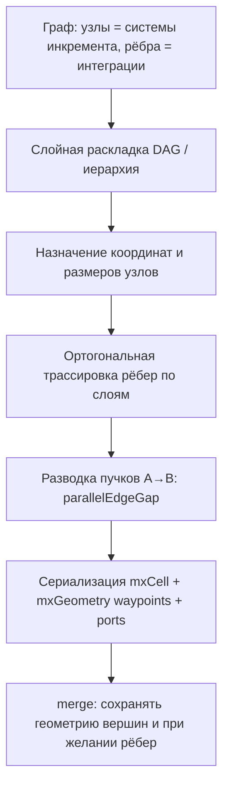

# Снижение наслоения связей на диаграммах draw.io (инкремент ADR)

Обсуждение: почему при **автогенерации** схемы решения связи накладываются друг на друга, и какие подходы дают **минимум пересечений** и **разводку параллельных** стрелок.

Связанные артефакты: [`drawio-increment-diagram-parameters.md`](./drawio-increment-diagram-parameters.md) (целевая модель), [`backend/incrementDiagram.js`](../backend/incrementDiagram.js) (фактическая генерация), эталон ручной разводки — [`diagrams/demo-full-model-metamodel-section7.drawio`](./diagrams/demo-full-model-metamodel-section7.drawio).

---

## 1. Где возникает проблема

Речь о **серверной** сборке `mxfile` для инкремента заключения (`buildMxfile` / `mergeMxfileWithData`), а не о графе «Анализ зависимостей» (там другой движок — `v-network-graph`, кривые рёбра и свои раскладки).

Цепочка:

1. Данные: системы инкремента + интеграции (`ar_adr_increment_systems`, `ar_adr_increment_relations`).
2. `backend/incrementDiagram.js` → XML draw.io.
3. Просмотр/правка в embed Draw.io (`DRAWIO_EMBED_BASE`).

---

## 2. Как устроено сейчас (почему наслоение неизбежно)

### 2.1. Раскладка узлов

Используется **простая сетка**, а не слойный граф:

- столбцов: `cols = min(4, ceil(sqrt(n)))`;
- шаг ячейки: `cellW = maxW + nodeSep`, `cellH = maxH + rankSep`;
- координаты: `x = margin + (i % cols) * cellW`, `y = margin + floor(i/cols) * cellH`;
- сортировка систем — по **имени** (алфавит), **не** по топологии интеграций.

Из `DRAWIO_LAYOUT_STYLE` в коде реально читаются только **`margin`**, **`nodeSep`**, **`rankSep`**. Поля **`algorithm`**, **`direction`**, **`edgeLabelReserveH/V`**, **`parallelEdgeGap`** в `incrementDiagram.js` **не применяются** (заданы в `drawioStyles.js` и в документации как цель, см. issue #53).

При **merge** после ручного сохранения диаграммы позиции **вершин** `sys-*` восстанавливаются из предыдущего `mxfile` (`extractVertexGeometryMap`), но **рёбра каждый раз создаются заново** без сохранённой геометрии.

### 2.2. Рёбра (интеграции)

Для каждой интеграции:

```text
edgeStyle=orthogonalEdgeStyle; rounded=0; orthogonalLoop=1; jettySize=auto; …
<mxGeometry relative="1" as="geometry"/>   <!-- без waypoints, без exit/entry -->
```

То есть:

- стиль — **ортогональный**, но **маршрут не задан**;
- Draw.io при открытии **сам** прокладывает ломаную линию между центрами портов по умолчанию;
- при **многих** рёбрах между близкими узлами или с одного узла алгоритм редактора часто выбирает **один и тот же коридор** → визуальное **наслоение** и пересечения.

В эталонной схеме метамодели (ручной draw.io) у рёбер явно заданы **`exitX` / `exitY` / `entryX` / `entryY`**, иногда **`Array` точек** в `mxGeometry` — поэтому параллельные связи **разведены** (см. три ребра `n-sys` → `n-par` с разными `exitY`).

---

## 3. Параметры: что влияет сегодня и что задумано

| Параметр | Где | Влияние на наслоение **сейчас** |
|----------|-----|----------------------------------|
| `DRAWIO_LAYOUT_STYLE.margin` | БД / config | Только отступ от края листа. |
| `DRAWIO_LAYOUT_STYLE.nodeSep` | БД / config | Расстояние между узлами в **сетке** (больше — меньше плотность, слабее эффект на маршруты). |
| `DRAWIO_LAYOUT_STYLE.rankSep` | БД / config | То же для второй оси сетки. |
| `DRAWIO_LAYOUT_STYLE.parallelEdgeGap` | БД / config | **Не используется** в генераторе. |
| `DRAWIO_LAYOUT_STYLE.algorithm` / `direction` | БД / config | **Не используются** (целевое: `layered_orthogonal`, `LR`). |
| `DRAWIO_LAYOUT_STYLE.edgeLabelReserveH/V` | БД / config | **Не используются** (резерв под подписи на сегментах). |
| `DRAWIO_NODE_STYLE.*` | БД / config | Размер узла → больше ячейка сетки → косвенно меньше тесноты. |
| `DRAWIO_EDGE_STYLE.labelFontSize` | БД / config | Размер подписи на ребре; без позиционирования label наслоение текста возможно. |
| Ручная геометрия в сохранённом `mxfile` | Пользователь в Draw.io | **Только вершины** переносятся при merge; **рёбра** пересчитываются редактором заново → ручная разводка рёбер **не сохраняется** при перегенерации. |

---

## 4. Целевой алгоритм (как в спецификации #53)

Ниже — **рекомендуемый** конвейер, согласованный с [`drawio-increment-diagram-parameters.md`](./drawio-increment-diagram-parameters.md), чтобы **минимизировать пересечения** и **не накладывать** параллельные стрелки.



### Шаг 1. Слойная раскладка вершин

- Вход: ориентированный граф интеграций (циклы — отдельная политика: разрыв ребром-заглушкой, слой «цикл», или оставить цикл и вынести на отдельный маршрут).
- Алгоритм: **Sugiyama / layered** (например **ELK layered**, **dagre**, или layout API mxGraph — что удобнее в Node на бэкенде).
- Параметры: `direction` (`LR` или `TB`), `rankSep`, `nodeSep`, плюс увеличение зазоров с учётом `edgeLabelReserveH/V` и длины подписей.
- Результат: `(x, y, width, height)` для каждого `sys-{id}`.

**Почему это снижает пересечения:** порядок узлов на слое подбирается так, чтобы рёбра между соседними слоями меньше пересекались; сетка по алфавиту этой информации **не использует**.

### Шаг 2. Ортогональная трассировка рёбер

После фиксации позиций узлов для **каждого** ребра:

1. Выбрать **сторону выхода** у source и **сторону входа** у target (в направлении `LR`: чаще `exitX=1` → `entryX=0`).
2. Построить **ломаную** из 2–4 сегментов под 90° (коридоры между слоями).
3. Записать в XML:
   - атрибуты стиля `exitX`, `exitY`, `entryX`, `entryY` (как в эталонной диаграмме);
   - при необходимости дочерние `<mxPoint>` в `<mxGeometry>` для промежуточных изломов.

**Почему не достаточно одного `orthogonalEdgeStyle` без геометрии:** автолейаут Draw.io при открытии **не детерминирован** относительно ваших данных и не знает про `parallelEdgeGap`.

### Шаг 3. Параллельные интеграции между одной парой (A → B)

Если несколько строк `ar_adr_increment_relations` с одинаковыми `from_ar_systems_id` и `to_ar_systems_id`:

- сгруппировать в **пучок**;
- для ребра с индексом `k` из `n` сместить трассу на **`k * parallelEdgeGap`** (перпендикулярно основному направлению потока: при `LR` — по вертикали, при `TB` — по горизонтали);
- подписи (`value` на ребре) смещать вместе с коридором (`edgeLabel` с `mxGeometry` offset), чтобы не перекрывать линию соседа.

Это прямое применение поля **`parallelEdgeGap`** из `DRAWIO_LAYOUT_STYLE`.

### Шаг 4. Много рёбер с **одного** узла (веер)

Когда из одной системы уходит много интеграций:

- **разнести порты** на грани фигуры: `exitY = (i+1)/(n+1)` для `i = 0..n-1` (как в эталоне для `n-sys` → `n-par`);
- при нехватке места увеличить **`nodeSep`** на слое или высоту узла (через `DRAWIO_NODE_STYLE`).

### Шаг 5. Merge и повторная генерация

Чтобы правки пользователя не терялись:

- расширить `extractVertexGeometryMap` → **`extractEdgeGeometryMap`** (id `rel-*`, waypoints, exit/entry);
- при `mergeMxfileWithData` **подставлять сохранённую геометрию рёбер**, если интеграция та же (тот же `rel-{id}`);
- для **новых** интеграций — только шаги 1–3.

---

## 5. Практические уровни внедрения (по трудозатратам)

| Уровень | Суть | Эффект на наслоение |
|--------|------|---------------------|
| **A. Быстрый** | Увеличить `nodeSep` / `rankSep`; меньше `cols` (шире сетка); сортировать узлы по **топологическому** порядку в сетке | Слабый, без гарантий |
| **B. Средний** | Реализовать только **parallelEdgeGap** + **разные exitY/entryY** для пучков и вееров; фиксированный `LR` | Хорошо для дублей A→B и вееров |
| **C. Полный (#53)** | ELK/dagre layered + ортогональный router + merge геометрии рёбер | Максимально близко к спецификации |
| **D. Операционный** | После генерации в Draw.io: **Arrange → Layout** (если допустимо ручное действие) | Зависит от редактора, не для headless |

---

## 6. Ограничения (честно)

- **Идеального** «ноль пересечений» для произвольного графа **нет** (NP-трудные задачи). Цель — **минимизация** пересечений и **отсутствие наложения** линий с одинаковым маршрутом.
- **Циклы** (интеграция system → system) требуют отдельной трассировки (петля с `Array` точек, как `eg-sys-loop` в эталоне).
- **Подписи** длиннее коридора между узлами — нужны `edgeLabelReserve*` и/или перенос текста в `edgeLabel` с `whiteSpace=wrap`.
- Пока генератор на **сетке** без трассировки, настройка только `DRAWIO_LAYOUT_STYLE` в БД **не включит** `layered_orthogonal` автоматически — нужна доработка `incrementDiagram.js` (или отдельный модуль layout).

---

## 7. Рекомендация для обсуждения с командой

1. Зафиксировать **целевой** уровень: **B** как MVP (пучки + порты), **C** как завершение issue #53.
2. В merge **сохранять геометрию рёбер**, иначе любая перегенерация снова откатит разводку.
3. Эталон визуала — **ручная** [`demo-full-model-metamodel-section7.drawio`](./diagrams/demo-full-model-metamodel-section7.drawio): при автоматизации копировать паттерн `exitX/exitY`, а не полагаться на `jettySize=auto` без точек.
4. Для проверки: тест-кейс «3+ интеграции A→B», «5+ исходящих из одного узла», «цикл A→A» — сравнение скриншота до/после.

---

## 8. Реализация в коде (варианты C + D)

| Компонент | Файл |
|-----------|------|
| Слойная раскладка (dagre), ортогональные маршруты, `parallelEdgeGap` | `backend/incrementDiagramLayout.js` |
| Сборка mxfile, merge геометрии вершин и рёбер | `backend/incrementDiagram.js` |
| Зависимость | `dagre` в корневом `package.json` |

- **C:** при новой диаграмме (`geometryMap` пуст) — `layoutNodes` с `algorithm: layered_orthogonal`, затем `computeEdgeRoutes` (порты `exitX/exitY`, waypoints).
- **D:** `extractEdgeGeometryMap` + при `mergeMxfileWithData` сохранённые маршруты `rel-*` подставляются вместо пересчёта; позиции `sys-*` — как раньше.
- **Merge:** узлы с сохранёнными координатами не пересчитываются; **новые** интеграции получают маршрут по текущим позициям узлов.
- Fallback: `algorithm` ≠ `layered_orthogonal` или сбой dagre → сетка по имени.

После обновления кода на сервере: `npm install` в корне репозитория (или пересборка Docker-образа API).

---

## 9. Правило «ближайшая сторона» (не проходить через вершины)

### Требование

1. **Стрелка не должна проходить через тело вершины** (ни source, ни target, по возможности — ни через другие узлы).
2. **Точка выхода** — с той **грани** source, которая **обращена к** target.
3. **Точка входа** — с той **грани** target, которая **обращена к** source.
4. На одной грани несколько рёбер — сдвиг вдоль ребра (`parallelEdgeGap`, доля `(i+1)/(n+1)`), а не через центр блока.

### Почему на практике линия «режет» блоки (как на примере)

В первой версии варианта **C** для режима `LR` зашито жёстко:

- выход **всегда** `exitX=1` (правая сторона source);
- вход **всегда** `entryX=0` (левая сторона target);
- излом — вертикальный «коридор» по `midX` между правым краем source и левым краем target.

Это верно **только** если target целиком **правее** source и примерно на одной высоте. На схеме:

| Связь | Расположение | Что ломается |
|--------|----------------|--------------|
| Оптиматика → ИС ПД | target **слева** | Выход **справа** из Оптиматики — линия сначала уходит «не туда»; вход **слева** в ИС ПД — грань **отвёрнута** от source; сегменты могут пересечь прямоугольники. |
| СУД → Оптиматика | target **выше** (доминирует вертикаль) | Горизонтальный коридор на середине по Y проходит **сквозь** оба блока. |

То есть проблема не в draw.io как таковом, а в том, что **стороны порта не выбираются по геометрии пары узлов**.

### Целевой алгоритм выбора стороны

Для пары прямоугольников `A` (source) и `B` (target):

1. Центры: `(cxA, cyA)`, `(cxB, cyB)`.
2. `dx = cxB - cxA`, `dy = cyB - cyA`.
3. Если `|dx| >= |dy|` — **горизонтальный** режим:
   - `dx > 0`: выход с **востока** A (`exitX=1`), вход с **запада** B (`entryX=0`);
   - `dx < 0`: выход с **запада** A (`exitX=0`), вход с **востока** B (`entryX=1`).
4. Если `|dx| < |dy|` — **вертикальный** режим:
   - `dy > 0`: выход с **юга** A (`exitY=1`), вход с **севера** B (`entryY=0`);
   - `dy < 0`: выход с **севера** A (`exitY=0`), вход с **юга** B (`entryY=1`).
5. Позиция вдоль выбранной грани — доля `exitY` / `exitX` / `entryY` / `entryX` (для разведения параллельных рёбер), **не** всегда середина, если несколько стрелок с одной стороны.
6. **Waypoints** строить **снаружи** ограничивающих прямоугольников A и B:
   - горизонтальный режим: сначала от периметра A до `x` между краями (снаружи), затем вертикаль до `y` входа, затем к периметру B;
   - вертикальный — симметрично по `y`.

```text
  [ A ]----->  коридор снаружи  ----->  [ B ]
         (не через центр A и не через центр B)
```

### Обход **третьих** узлов

Правило ближайшей стороны убирает прохождение **через концы** связи. Если между A и B на пути лежит узел C, нужен дополнительный шаг (коридорный routing / подъём `rankSep`, сдвиг слоя в dagre, или 1–2 дополнительные точки изгиба вокруг bbox C). Это отдельное усиление поверх «ближайшей стороны».

### Статус в коде

| Правило | `incrementDiagramLayout.js` |
|---------|---------------------------|
| Слойная раскладка dagre | есть |
| `parallelEdgeGap` | есть |
| **Ближайшая сторона по dx/dy** | **реализовано** (`pickSides` + `orthogonalRouteNearestSide` в `incrementDiagramLayout.js`) |
| Обход посторонних узлов | не реализован |

### Связь с ручной эталонной схемой

В [`demo-full-model-metamodel-section7.drawio`](./diagrams/demo-full-model-metamodel-section7.drawio) у каждого ребра заданы свои `exitX/exitY/entryX/entryY` под фактическое положение фигур — это и есть «ближайшая сторона» вручную. Автогенератор должен воспроизводить ту же логику выбора грани, а не один шаблон на все рёбра.
