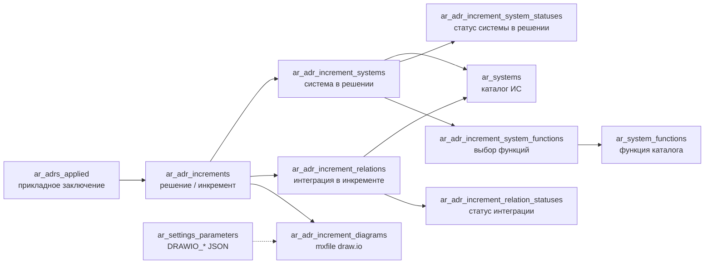

# Параметры стилей и раскладки схем решения (draw.io)

GitHub: https://github.com/dgabadulin/ArchRep/issues/53

Документ фиксирует **вариант B**: коды параметров с префиксом `DRAWIO_`, значения в `archrep.ar_settings_parameters`, чтение через `getParam` и (после добавления в `PUBLIC_CONFIG_DEFAULTS`) выдача в **`GET /api/config`**.

Связанные договорённости по содержанию и поведению генератора см. в разделе [Договорённости](#договорённости).

---

## Договорённости

### Источник данных

- Узлы строятся по **системам в выбранном решении (инкременте)** архитектурного заключения: имя системы, **функции** (тот же текст, что в поле «Функции» / синхронизация с перечнем функций).
- Рёбра — по **интеграциям** этого решения: источник, приёмник, подпись (наименование/описание); **цвет линии** — по статусу интеграции (маппинг задаётся внутри **`DRAWIO_EDGE_STYLE`**).

### Внешний вид узлов (системы)

- Форма: **прямоугольник со скруглёнными углами**.
- **Заливка** зависит от **статуса системы в решении**; маппинг **`code`** → `#RRGGBB` — поле **`nodeStatusColor`** внутри **`DRAWIO_NODE_STYLE`** (коды — в [справочнике статусов системы](#справочник-ar_adr_increment_system_statuses); колонка `code` вводится миграцией `DB/scripts/migrate_adr_increment_system_statuses_code.sql`).
- **Название системы**: сверху, по центру, **крупный жирный** шрифт (поля **`titleFontSize`**, **`titleBold`**).
- **Функции**: внутри фигуры **списком**, **выравнивание по левому краю** (многострочный текст с переносами; ширина переноса — **`maxTextWidth`**).

### Внешний вид рёбер (интеграции)

- Отображение: **стрелки** от системы-источника к системе-приёмнику.
- **Цвет линии** зависит от **статуса интеграции**; маппинг — поле **`edgeStatusColor`** внутри **`DRAWIO_EDGE_STYLE`** (ключи — **`code`** из справочника **`archrep.ar_adr_increment_relation_statuses`**; в UI иногда видно короткое имя без префикса `ar_adr_`).
- **Онлайн / офлайн** (по легенде: сплошная vs пунктир) — **в первой версии не реализуем**; стили задаются вложенными объектами **`onlineLineStyle`** / **`offlineLineStyle`** внутри **`DRAWIO_EDGE_STYLE`** (см. описание полей и [пример полного JSON](#пример-полного-json-для-drawio_edge_style)).
- **Подписи** к стрелкам размещаются **вдоль** линии: на **горизонтальных** участках — **над** стрелкой, на **вертикальных** — **слева** от стрелки.
- Подписи должны **полностью помещаться**; при нехватке места предусмотрены резервы и итеративная подстройка отступов (поля **`edgeLabelReserveH`** / **`edgeLabelReserveV`** внутри **`DRAWIO_LAYOUT_STYLE`**).

### Раскладка и пересечения

- Предпочтительный класс алгоритмов: **слои (layered) + ортогональная** прокладка рёбер, упорядочивание вершин на слоях для **минимизации пересечений**.
- Размер узла: **оценка по содержимому** (заголовок + переносы функций), минимальные габариты и отступы из **`DRAWIO_NODE_STYLE`**; при необходимости **округление до сетки** (`gridStep` в **`DRAWIO_NODE_STYLE`**).
- Расстояния между узлами (`rankSep` / `nodeSep` в **`DRAWIO_LAYOUT_STYLE`**) учитывают **резерв под подписи** на инцидентных рёбрах.

### Параметризация

- Стили **узла**, **ребра** и **раскладки диаграммы** заданы **одним JSON на сущность**: **`DRAWIO_NODE_STYLE`**, **`DRAWIO_EDGE_STYLE`**, **`DRAWIO_LAYOUT_STYLE`** (`value_type`: `json`).
- Ключи в **`edgeStatusColor`**: стабильный **`code`** из `archrep.ar_adr_increment_relation_statuses.code`. Ключи в **`nodeStatusColor`**: стабильный **`code`** из `archrep.ar_adr_increment_system_statuses.code` (после миграции; см. [справочник](#справочник-ar_adr_increment_system_statuses)).
- Значения по умолчанию согласованы с **организационной легендой**; конкретные hex в примерах — стартовые, правка через БД без релиза.

### Связь с draw.io в проекте

- Базовый URL встраивания редактора задаётся существующим параметром **`DRAWIO_EMBED_BASE`** (env / config); префикс `DRAWIO_` для новых ключей с ним согласован.

---

## Таблица параметров (вариант B, префикс `DRAWIO_`)

Поле **Тип в БД** — значение `value_type` в `ar_settings_parameters` (`json`, `number`, `string`, `boolean` поддерживаются в `settingsParams.parseValue`).

| Код параметра                        | Тип в БД | Значение по умолчанию | Описание |
| ------------------------------------ | -------- | --------------------- | -------- |
| `DRAWIO_NODE_STYLE`                  | `json`   | См. [схему и пример](#drawio_node_style) | Единый объект настроек **узла** (системы): цвета по статусам, типографика, отступы, габариты, скругление, шаг сетки для округления размеров. |
| `DRAWIO_EDGE_STYLE`                  | `json`   | См. [схему и пример](#drawio_edge_style) | Единый объект настроек **ребра** (интеграции): цвет линии по статусу, подпись на стрелке, отложенные стили онлайн/офлайн. |
| `DRAWIO_LAYOUT_STYLE`                | `json`   | См. [схему и пример](#drawio_layout_style) | Единый объект настроек **раскладки**: алгоритм, направление, поля, зазоры между слоями и узлами, резервы под подписи на рёбрах, разводка параллельных стрелок. |

Параметры из таблицы при внедрении нужно добавить в **`PUBLIC_CONFIG_DEFAULTS`** в `backend/index.js` и при необходимости в **`DEFAULTS`** в `frontend-v3/src/config/params.js`, чтобы `GET /api/config` и фронт получали те же значения по умолчанию.

---

## `DRAWIO_NODE_STYLE` {#drawio_node_style}

Один объект JSON. Все поля ниже — **опции внутри этого объекта** (имена в **camelCase**; при чтении допускается нормализация на бэкенде).

| Поле (ключ JSON) | Тип значения | Пример / умолчание | Описание |
| ---------------- | ------------ | -------------------- | -------- |
| `nodeStatusColor` | `object` | см. [фрагмент A](#фрагмент-a-nodestatuscolor-заливка-узла) | Объект **«`code` статуса из `ar_adr_increment_system_statuses` → цвет заливки»** (`#RRGGBB`). Перечень кодов — в [таблице справочника](#справочник-ar_adr_increment_system_statuses). |
| `nodeStatusStroke` | `object` | `{}` или см. [фрагмент B](#фрагмент-b-nodestatusstroke-обводка-узла) | Необязательно. **«код статуса → цвет обводки»** (`#RRGGBB`). Пустой объект — обводка по умолчанию движка / тонкая нейтральная. |
| `titleFontSize` | `number` | `14` | Размер шрифта **названия системы** (заголовок внутри узла), в px логических единиц диаграммы. |
| `titleBold` | `boolean` | `true` | Жирное начертание заголовка. |
| `bodyFontSize` | `number` | `11` | Размер шрифта **списка функций** под заголовком. |
| `bodyLineHeight` | `number` | `1.25` | Межстрочный интервал текста функций как **множитель** к `bodyFontSize` (например 1.25 = +25 % к высоте строки). |
| `paddingH` | `number` | `12` | Внутренний отступ узла **слева и справа** от границы фигуры до текста, px. |
| `paddingV` | `number` | `10` | Внутренний отступ **сверху и снизу**, px. |
| `minWidth` | `number` | `140` | Минимальная ширина прямоугольника **после** расчёта по тексту; если оценка меньше — расширить до этого значения. |
| `minHeight` | `number` | `72` | Минимальная высота узла по той же логике. |
| `maxTextWidth` | `number` | `280` | Максимальная ширина **области переноса** текста функций; заголовок может центрироваться в полной ширине узла, тело — с переносами по этой ширине. |
| `cornerRadius` | `number` | `8` | Радиус скругления углов прямоугольника (draw.io / mxGraph), px. |
| `gridStep` | `number` | `8` | Шаг сетки для **округления вверх** вычисленных ширины и высоты узла (чтобы размеры были кратны шагу, ровнее стыкуются в раскладке). |

### Справочник `ar_adr_increment_system_statuses` {#справочник-ar_adr_increment_system_statuses}

Таблица: **`archrep.ar_adr_increment_system_statuses`**. Колонка **`code`** добавляется скриптом **`DB/scripts/migrate_adr_increment_system_statuses_code.sql`**; префикс **`ADR_INCR_SYS_`** согласован со статусами интеграций (`ADR_INCR_REL_`).

| id | name | description | code |
| --: | --- | --- | --- |
| 1 | Создается | Система создается в рамках решения | `ADR_INCR_SYS_CREATING` |
| 2 | Используется | Система участвует в реализации решения (без изменений) | `ADR_INCR_SYS_IN_USE` |
| 3 | Модифицируется | Система дорабатывается в рамках решения | `ADR_INCR_SYS_MODIFYING` |
| 4 | Выводится из эксплуатации | Система выводится из эксплуатации | `ADR_INCR_SYS_DECOMMISSIONING` |
| 5 | Создается в другом решении | Система реализуется в рамках другого проекта/бизнес-инициативы | `ADR_INCR_SYS_OTHER_SOLUTION` |

Генератор и **`DRAWIO_NODE_STYLE`**: ключи в `nodeStatusColor` — **ровно эти `code`**. API при выдаче статуса строки инкремента должен отдавать **`code`** справочника (или клиент резолвит `ar_adr_increment_system_statuses_id` → `code`).

### Фрагмент A: `nodeStatusColor` (заливка узла)

Ключи — значения **`code`** из таблицы выше. Hex ниже ориентировочно под организационную легенду (светло-зелёный / жёлтый / лососевый / серый / голубой); подстройте под утверждённые цвета.

```json
{
  "ADR_INCR_SYS_IN_USE": "#C8E6C9",
  "ADR_INCR_SYS_CREATING": "#FFF9C4",
  "ADR_INCR_SYS_MODIFYING": "#FFCCBC",
  "ADR_INCR_SYS_DECOMMISSIONING": "#ECEFF1",
  "ADR_INCR_SYS_OTHER_SOLUTION": "#BBDEFB"
}
```

### Фрагмент B: `nodeStatusStroke` (обводка узла, опционально)

```json
{
  "ADR_INCR_SYS_IN_USE": "#81C784",
  "ADR_INCR_SYS_DECOMMISSIONING": "#B0BEC5"
}
```

### Пример полного JSON для `DRAWIO_NODE_STYLE`

```json
{
  "nodeStatusColor": {
    "ADR_INCR_SYS_IN_USE": "#C8E6C9",
    "ADR_INCR_SYS_CREATING": "#FFF9C4",
    "ADR_INCR_SYS_MODIFYING": "#FFCCBC",
    "ADR_INCR_SYS_DECOMMISSIONING": "#ECEFF1",
    "ADR_INCR_SYS_OTHER_SOLUTION": "#BBDEFB"
  },
  "nodeStatusStroke": {},
  "titleFontSize": 14,
  "titleBold": true,
  "bodyFontSize": 11,
  "bodyLineHeight": 1.25,
  "paddingH": 12,
  "paddingV": 10,
  "minWidth": 140,
  "minHeight": 72,
  "maxTextWidth": 280,
  "cornerRadius": 8,
  "gridStep": 8
}
```

---

## `DRAWIO_EDGE_STYLE` {#drawio_edge_style}

Один объект JSON. Поля — настройки **линии интеграции** и **подписи**; отложенные режимы онлайн/офлайн включены в тот же объект.

| Поле (ключ JSON) | Тип значения | Пример / умолчание | Описание |
| ---------------- | ------------ | -------------------- | -------- |
| `edgeStatusColor` | `object` | см. [фрагмент C](#фрагмент-c-edgestatuscolor-цвет-линии) | Объект **«`code` статуса из `ar_adr_increment_relation_statuses` → цвет линии (`#RRGGBB`)»**. Перечень кодов — в [таблице справочника](#справочник-ar_adr_increment_relation_statuses). |
| `labelFontSize` | `number` | `10` | Размер шрифта **текста подписи** на стрелке (наименование/описание интеграции). |
| `labelOffsetAbove` | `number` | `8` | Смещение подписи **от горизонтального сегмента** линии в сторону «наружу» (типично — **над** сегментом при горизонтальной трассировке), px. |
| `labelOffsetLeft` | `number` | `8` | Смещение подписи **от вертикального сегмента** (типично — **слева** от вертикали при `LR`-раскладке), px. Знак может инвертироваться в коде в зависимости от направления графа — зафиксировать при реализации. |
| `onlineLineStyle` | `object` | см. ниже | **Не используется в первой версии** генератора. Заранее заданный стиль для **онлайн**-передачи: сплошная линия, толщина, при необходимости цвет по умолчанию. |
| `offlineLineStyle` | `object` | см. ниже | **Не используется в первой версии**. Стиль для **офлайн**: пунктир (`dashed`, `dashPattern`), толщина. |

Содержимое `onlineLineStyle` / `offlineLineStyle` (пример; формат пунктира сверить с mxGraph/draw.io):

| Подполе | Тип | Пример | Описание |
| ------- | --- | ------ | -------- |
| `dashed` | `boolean` | `false` / `true` | Пунктирная ли линия. |
| `strokeWidth` | `number` | `2` | Толщина линии, px. |
| `dashPattern` | `string` | `"8 4"` | Только для пунктира: шаблон штрихов в терминах движка. |

### Справочник `ar_adr_increment_relation_statuses` {#справочник-ar_adr_increment_relation_statuses}

Полное имя в БД: **`archrep.ar_adr_increment_relation_statuses`** (не путать с условным ярлыком «`ar_increment_relation_statuses`» без префикса `ar_adr_`). Уникальный стабильный ключ для параметров — колонка **`code`**.

| id | name | description | code |
| --: | --- | --- | --- |
| 1 | Создается | Интеграционный поток запланирован к реализации | `ADR_INCR_REL_CREATING` |
| 2 | Модифицируется | Дорабатывается существующий интеграционный поток | `ADR_INCR_REL_MODIFYING` |
| 3 | Используется | В рамках решения используется существующий интеграционный поток | `ADR_INCR_REL_IN_USE` |
| 4 | Удаляется | Интеграционный поток удаляется | `ADR_INCR_REL_REMOVING` |

### Фрагмент C: `edgeStatusColor` (цвет линии)

Ключи JSON — **точно значения `code`** из таблицы выше. Цвета ниже — **иллюстрация** для старта; подставьте hex из организационной легенды.

```json
{
  "ADR_INCR_REL_CREATING": "#5C6BC0",
  "ADR_INCR_REL_MODIFYING": "#F57C00",
  "ADR_INCR_REL_IN_USE": "#212121",
  "ADR_INCR_REL_REMOVING": "#C62828"
}
```

### Пример полного JSON для `DRAWIO_EDGE_STYLE` {#пример-полного-json-для-drawio_edge_style}

```json
{
  "edgeStatusColor": {
    "ADR_INCR_REL_CREATING": "#5C6BC0",
    "ADR_INCR_REL_MODIFYING": "#F57C00",
    "ADR_INCR_REL_IN_USE": "#212121",
    "ADR_INCR_REL_REMOVING": "#C62828"
  },
  "labelFontSize": 10,
  "labelOffsetAbove": 8,
  "labelOffsetLeft": 8,
  "onlineLineStyle": {
    "dashed": false,
    "strokeWidth": 2
  },
  "offlineLineStyle": {
    "dashed": true,
    "dashPattern": "8 4",
    "strokeWidth": 2
  }
}
```

---

## `DRAWIO_LAYOUT_STYLE` {#drawio_layout_style}

Один объект JSON. Настройки **алгоритма размещения узлов и трассировки рёбер** на странице диаграммы (не визуальный стиль отдельной фигуры). Имена полей — **camelCase**.

| Поле (ключ JSON) | Тип значения | Пример / умолчание | Описание |
| ---------------- | ------------ | -------------------- | -------- |
| `algorithm` | `string` | `layered_orthogonal` | Идентификатор режима раскладки: ожидается **слойная** топология с **ортогональными** (ломаная 90°) рёбрами; точное имя должно совпасть с тем, что реализует генератор (ELK, встроенный layout mxGraph и т.д.). |
| `direction` | `string` | `LR` | Направление «потока» графа: `LR` — слева направо (уровни колонками), `TB` — сверху вниз (уровни строками). Влияет на смысл «ранга» и на то, какие сегменты рёбер считаются горизонтальными/вертикальными для подписей из **`DRAWIO_EDGE_STYLE`**. |
| `margin` | `number` | `40` | Внешнее **поле** вокруг всей диаграммы (отступ от края холста до ближайших узлов), px. |
| `rankSep` | `number` | `80` | Базовый зазор **между слоями** (между «уровнями» в направлении `direction`): расстояние между «колонками» при `LR` или между «рядами» при `TB`, px. При расчёте может **увеличиваться**, если учитываются высота/ширина подписей на рёбрах между слоями. |
| `nodeSep` | `number` | `40` | Базовый зазор **между узлами на одном слое** (внутри одной «колонки» или одного «ряда»), px. |
| `edgeLabelReserveH` | `number` | `24` | Дополнительный **горизонтальный** резерв под подписи на рёбрах: «толщина коридора», чтобы метки не наезжали на узлы и соседние рёбра при ортогональной разводке, px. |
| `edgeLabelReserveV` | `number` | `20` | Дополнительный **вертикальный** резерв под подписи, px; аналогично учитывается при подборе `rankSep` / `nodeSep`. |
| `parallelEdgeGap` | `number` | `12` | Смещение между **параллельными** стрелками, идущими между **одной и той же парой** узлов (несколько интеграций A→B), px — чтобы линии и подписи не сливались. |

### Пример полного JSON для `DRAWIO_LAYOUT_STYLE`

```json
{
  "algorithm": "layered_orthogonal",
  "direction": "LR",
  "margin": 40,
  "rankSep": 80,
  "nodeSep": 40,
  "edgeLabelReserveH": 24,
  "edgeLabelReserveV": 20,
  "parallelEdgeGap": 12
}
```

---

## Контекст схемы БД

Ниже — выжимка по **актуальной схеме `archrep`** (снимок DDL), достаточная для наполнения схемы draw.io из архитектурного заключения: заключение → инкремент → системы и интеграции → каталог систем и функций → параметры и хранение диаграммы. Полный скрипт (последовательности, все таблицы, функции) — внешний артефакт развёртывания; в репозитории детали см. в `DB/schema/` и миграциях.

### Цепочка сущностей (логическая)



### Таблицы и поля (релевантные генератору)

| Таблица | Назначение | Ключевые столбцы |
| --------| -----------| -----------------|
| `archrep.ar_adrs_applied` | Запись прикладного ADR | `id`, `code`, текст заключения, `ar_adr_statuses_id` |
| `archrep.ar_adr_increments` | Инкремент (решение) внутри заключения | `id`, `ar_adrs_applied_id` → заключение, `order_index`, `name`, `ar_adr_increment_types_id` |
| `archrep.ar_adr_increment_systems` | Система, включённая в инкремент | `id`, `ar_adr_increment_id`, `ar_systems_id` → каталог, `ar_adr_increment_system_statuses_id` → статус в решении, `comment` — текст «Функции» (синхронизируется с выбором функций) |
| `archrep.ar_adr_increment_system_statuses` | Справочник статуса системы **в решении** | `id`, `name`, `description`, **`code`** (уникален; вводится миграцией, см. [справочник](#справочник-ar_adr_increment_system_statuses)) |
| `archrep.ar_systems` | Каталог ИС / модулей | `id`, `code`, `name`, `fullname`, … |
| `archrep.ar_system_functions` | Каталог функций по системе | `id`, `ar_systems_id`, `name`, `description`, уникальность по `(ar_systems_id, lower(trim(name)))` |
| `archrep.ar_adr_increment_system_functions` | Связь строки «система в инкременте» с функцией и порядок | `ar_adr_increment_system_id`, `ar_system_functions_id`, `sort_order` |
| `archrep.ar_adr_increment_relations` | Интеграция в инкременте | `id`, `ar_adr_increment_id`, `from_ar_systems_id`, `to_ar_systems_id`, `name`, `description`, `ar_adr_increment_relation_statuses_id` |
| `archrep.ar_adr_increment_relation_statuses` | Справочник статуса интеграции в решении | `id`, `code` (**уникален**, стабильный ключ для параметров), `name`, `description` |
| `archrep.ar_adr_increment_diagrams` | Версии схемы draw.io для инкремента | `id`, `ar_adr_increment_id`, `version_no`, `mxfile`, метаданные правок |
| `archrep.ar_settings_parameters` | Параметры приложения, в т.ч. JSON стилей | `code`, `value`, `value_type` (`json` для `DRAWIO_NODE_STYLE` и др.) |

### Связь с реестром потоков (опционально)

`archrep.ar_integration_flows` может ссылаться на заключение и на строку интеграции (`ar_adrs_applied_id`, `ar_adr_increment_relation_id`). Для **автогенерации картинки инкремента** основной источник рёбер — таблица **`ar_adr_increment_relations`**; реестр потоков — отдельный контур учёта.

### Ключи в `DRAWIO_NODE_STYLE.nodeStatusColor`

Используются значения **`ar_adr_increment_system_statuses.code`** (после выполнения миграции **`DB/scripts/migrate_adr_increment_system_statuses_code.sql`**). Перечень кодов — [в таблице выше](#справочник-ar_adr_increment_system_statuses).

---

## Риски и последующие уточнения

- **Циклы** в графе интеграций: отдельно зафиксировать допустимость и стратегию.
- **Несколько интеграций** между одной парой систем: разводка через поле **`parallelEdgeGap`** в **`DRAWIO_LAYOUT_STYLE`**.
- **Вывод из эксплуатации** (красный крестик в легенде): при необходимости отдельный код статуса в `edgeStatusColor` / оформление узла в `nodeStatusColor`.
- **Онлайн/офлайн**: до включения в генератор полей `onlineLineStyle` / `offlineLineStyle` и признака в данных интеграции формат `dashPattern` не критичен; после включения — сверить с mxGraph/draw.io.

---

## Связанные артефакты в репозитории

- Загрузка параметров: `backend/settingsParams.js`
- Публичный конфиг API: `GET /api/config`, объект `PUBLIC_CONFIG_DEFAULTS` в `backend/index.js`
- Фронт: `frontend-v3/src/config/params.js`
