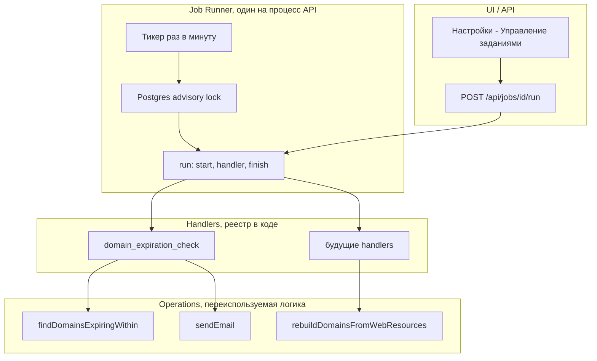

# Планировщик заданий (Job Runner) и проверка сроков доменов

Документ фиксирует **согласованные договорённости** по универсальному механизму периодических заданий в ИСАР и первому сценарию — **email-уведомления об истекающих доменах** реестра `ar_domains`.

**GitHub:** https://github.com/dgabadulin/ArchRep/issues/68

**Связанные материалы:** [domain-registry-schema.md](./domain-registry-schema.md) (#67, поле `expires_at`), [settings-parameters-design.md](./settings-parameters-design.md), [access-control-design.md](./access-control-design.md), [domainRebuild.js](../backend/domainRebuild.js) (пример переиспользуемой operation), dual-миграции (`.cursor/rules/db-migrations-dual.mdc`).

**Статус:** согласовано к реализации (обсуждение 2026-08-14 — 2026-08-17).

---

## 1. Назначение

1. **Job Runner** — лёгкий планировщик **внутри процесса API** (Node): периодически запускает зарегистрированные **handlers**, пишет **историю выполнения**, поддерживает **ручной запуск** и **вкл/выкл** из UI.
2. **Первое задание** — раз в **3 суток** проверять `ar_domains.expires_at` и при наличии доменов в настроенном окне отправлять **одно письмо** со списком на адрес из параметра БД.

Задания могут быть не только про рассылку: тот же каркас подходит для **массовых операций** (пересборка проекций, наполнение реестров и т.п.), если логика вынесена в переиспользуемую **operation**.

---

## 2. Согласованные решения (бизнес-правила)

| № | Тема | Решение |
|---|------|---------|
| 1 | Периодичность | Автозапуск **раз в 3 суток** (`interval_seconds = 259200`) от момента **последнего успешного** завершения |
| 2 | Окно отбора доменов | Только параметр **`CHK_DOMAIN_EXPIRATION`** (число дней). Отдельного «ближайший месяц» нет; дефолт параметра = **30** |
| 3 | Условие по дате | `expires_at IS NOT NULL` **и** `expires_at >= CURRENT_DATE` **и** `expires_at <= CURRENT_DATE + CHK_DOMAIN_EXPIRATION` |
| 4 | Уже истёкшие | **Не включаются** (`expires_at < сегодня` — вне выборки) |
| 5 | Статусы | Исключить домены со статусом **`rejected`** (`ar_domain_statuses.code = 'rejected'`) |
| 6 | Без даты | Домены с пустым `expires_at` — **пропуск** |
| 7 | Пустой результат | Письмо **не отправлять**; в истории run — `success`, `domains_found: 0` |
| 8 | Повторные письма | **Допустимо**: пока домен остаётся в окне, при каждом успешном цикле (каждые 3 дня) письмо может уходить снова |
| 9 | Получатель | Параметр БД **`CHK_DOMAIN_EXPIRATION_EMAIL`** (один адрес или несколько через запятую) |
| 10 | SMTP | Только **env** (секреты не в БД); значения заполняет администратор на стенде |
| 11 | UI | **Настройки → Управление заданиями** — список заданий, вкл/выкл, «Запустить сейчас», **история выполнения** (с первого релиза) |
| 12 | Создание заданий из UI | **Не в MVP** — новое задание = код + сид в БД (см. §8) |

---

## 3. Архитектура: три слоя



### 3.1. Programmatic unit = **Job Handler**

**Запускается не строка в БД и не HTTP-роут**, а **async-функция handler**, зарегистрированная в коде по **`code`** задания.

Контракт handler:

```javascript
/**
 * @param {JobContext} ctx
 * @returns {Promise<JobResult>}  // JSON summary для ar_job_runs.result_json
 */
async function exampleHandler(ctx) { ... }
```

**`JobContext`** (передаёт runner):

| Поле | Назначение |
|------|------------|
| `pool` | Подключение Postgres |
| `getParam(code, default)` | Параметры из `ar_settings_parameters` (кэш `settingsParams.js`) |
| `trigger` | `'schedule'` \| `'manual'` |
| `jobCode` | Код задания, напр. `domain_expiration_check` |
| `runId` | id записи в `ar_job_runs` |
| `log(message)` | Опционально — доп. строки в историю |
| Сервисы | `sendEmail(...)`, `queries`, и т.д. |

**Handler обязан:**

- вернуть структурированный **`JobResult`** (объект для `result_json`);
- **бросить ошибку** при фатальном сбое — runner помечает run как `failed`.

**Handler не должен:**

- решать «пора ли по расписанию» (это runner);
- писать в `ar_job_runs` / обновлять `ar_jobs.last_*` (это runner);
- знать про HTTP/UI.

### 3.2. **Operation** — переиспользуемая бизнес-логика

Отдельный модуль, **без** привязки к расписанию. Пример в проекте: `rebuildDomainsFromWebResources()` в `backend/domainRebuild.js` — вызывается из **Сервисных операций** и может быть вызван из **handler** задания.

Operation может:

- только читать данные и формировать отчёт;
- изменять БД (массовая операция);
- вызывать внешние системы (SMTP, HTTP).

### 3.3. **Runner** — инфраструктура

Один экземпляр на процесс API:

1. Тикер (~1 мин): выбрать **due**-задания.
2. **`pg_try_advisory_lock`** по hash(`job.code`) — не дублировать при двух контейнерах.
3. `INSERT ar_job_runs` → `status = running`.
4. `await handlers[job.code](ctx)`.
5. Успех → `success` + `result_json`; обновить `ar_jobs.last_finished_at`, `last_status`, `last_success_at`.
6. Ошибка → `failed` + `error_message`.
7. Снять lock.

**Due-условие:**

```text
enabled = true
AND (
  last_success_at IS NULL
  OR now() - last_success_at >= interval_seconds
)
```

**Ручной запуск** — тот же pipeline, `trigger = 'manual'`. Успешный manual run **обновляет** `last_success_at` (следующий auto-run — через `interval_seconds` после него).

Если в БД есть `code`, а handler в реестре отсутствует — run **`failed`**, сообщение «unknown handler».

### 3.4. Строка **`ar_jobs`** — метаданные, не код

| Поле | Смысл |
|------|--------|
| `code` | Уникальный ключ = ключ в реестре handlers |
| `name`, `description` | Для UI |
| `handler` | Дублирует `code` (для отладки/аудита) |
| `interval_seconds` | Интервал между **успешными** автозапусками |
| `enabled` | Вкл/выкл (редактируется из UI) |
| `last_started_at`, `last_finished_at`, `last_status` | Кэш для списка заданий |

Тип задания (**уведомление / массовая операция / комбо**) **не хранится** в БД — определяется поведением handler; UI универсален.

---

## 4. Первое задание: `domain_expiration_check`

### 4.1. Handler

**Код:** `domain_expiration_check`

**Шаги:**

1. Прочитать `CHK_DOMAIN_EXPIRATION` (default 30) и `CHK_DOMAIN_EXPIRATION_EMAIL`.
2. Вызвать operation выборки доменов (§4.2).
3. Если список пуст — вернуть `{ domains_found: 0, email_sent: false }`.
4. Если email пустой — **не слать**; вернуть `{ domains_found: N, email_sent: false, skip_reason: 'no_recipient' }` (статус run — `success`, предупреждение в message).
5. Иначе — сформировать HTML/text таблицу и вызвать `sendEmail()`.
6. Вернуть `{ domains_found, email_sent: true, recipients, domain_ids? }`.

### 4.2. Operation: выборка доменов

Псевдо-SQL:

```sql
SELECT d.id, d.name, d.expires_at, ...
FROM archrep.ar_domains d
JOIN archrep.ar_domain_statuses s ON s.id = d.ar_domain_statuses_id
WHERE d.expires_at IS NOT NULL
  AND d.expires_at >= CURRENT_DATE
  AND d.expires_at <= CURRENT_DATE + :threshold_days
  AND s.code <> 'rejected'
ORDER BY d.expires_at, d.name;
```

**Содержимое письма (минимум):** имя домена, `expires_at`, дней до истечения, статус, регистратор, владелец от бизнеса (если есть в join).

### 4.3. Сид задания

| Поле | Значение |
|------|----------|
| `code` / `handler` | `domain_expiration_check` |
| `name` | Проверка сроков доменов |
| `description` | Email со списком доменов, истекающих в течение CHK_DOMAIN_EXPIRATION дней |
| `interval_seconds` | `259200` (3 суток) |
| `enabled` | `true` |

---

## 5. Параметры и окружение

### 5.1. Параметры БД (`ar_settings_parameters`)

Сид при миграции (группа **«Проверки»**):

| Код | Тип | Default | Описание |
|-----|-----|---------|----------|
| `CHK_DOMAIN_EXPIRATION` | number | `30` | Порог в днях: домены с `expires_at` от сегодня до сегодня+N |
| `CHK_DOMAIN_EXPIRATION_EMAIL` | string | _(пусто)_ | Получатель(и) уведомления; несколько адресов через запятую |

Приоритет чтения — как у прочих параметров: env (если заведём override) → БД → default в handler.

### 5.2. SMTP (только env)

Шаблон в `.env.example` (значения на стенде задаёт администратор):

| Переменная | Назначение |
|------------|------------|
| `SMTP_HOST` | Хост SMTP |
| `SMTP_PORT` | Порт |
| `SMTP_SECURE` | `true` / `false` (TLS) |
| `SMTP_USER` | Логин (если нужен) |
| `SMTP_PASS` | Пароль |
| `MAIL_FROM` | Адрес отправителя |

Без `SMTP_HOST` / `MAIL_FROM` отправка падает с понятной ошибкой в истории run.

---

## 6. Модель данных (dual-миграция)

### 6.1. `archrep.ar_jobs`

| Колонка | Тип | Описание |
|---------|-----|----------|
| id | bigserial PK | |
| code | varchar UNIQUE NOT NULL | Ключ handler |
| name | varchar NOT NULL | Заголовок в UI |
| description | text | |
| handler | varchar NOT NULL | = code |
| interval_seconds | int NOT NULL | Интервал после last_success |
| enabled | boolean NOT NULL DEFAULT true | |
| last_started_at | timestamptz | |
| last_finished_at | timestamptz | |
| last_success_at | timestamptz | Для due-логики |
| last_status | varchar | `success` \| `failed` \| `running` |
| created_at, updated_at | timestamptz | |

### 6.2. `archrep.ar_job_runs`

| Колонка | Тип | Описание |
|---------|-----|----------|
| id | bigserial PK | |
| job_id | FK → ar_jobs | |
| started_at | timestamptz NOT NULL | |
| finished_at | timestamptz | |
| status | varchar NOT NULL | `running` \| `success` \| `failed` |
| trigger | varchar NOT NULL | `schedule` \| `manual` |
| message | text | Краткий итог для UI |
| error_message | text | При failed |
| result_json | jsonb | Структурированный JobResult |
| triggered_by_user_id | bigint NULL FK | При manual — кто нажал (если auth включён) |

---

## 7. API и RBAC

### 7.1. Endpoints

| Метод | Путь | Назначение |
|-------|------|------------|
| GET | `/api/jobs` | Список заданий + агрегаты last run |
| GET | `/api/jobs/:id/runs` | История (пагинация, newest first) |
| POST | `/api/jobs/:id/run` | Ручной запуск |
| PATCH | `/api/jobs/:id` | Только `{ enabled: boolean }` |

### 7.2. Permissions (новые)

| Permission | Назначение |
|------------|------------|
| `jobs:read` | Список заданий и история |
| `jobs:execute` | Ручной запуск, вкл/выкл |

**Роли:** `REPOSITORY_ADMIN`, `SYSTEM_ADMIN` (как у `service_operations:execute`).

Runner **не требует** JWT — работает в фоне процесса API.

### 7.3. UI

- Меню: **Настройки → Управление заданиями** (`/settings/jobs`).
- Таблица: название, интервал (человекочитаемо «3 дня»), enabled, последний запуск, статус.
- Действия: **Запустить**, переключатель **Вкл/Выкл**.
- Блок **История**: таблица runs (время, trigger, status, message; раскрытие `result_json`).

---

## 8. Как добавить новое задание (чеклист)

Использовать при каждом новом периодическом сценарии.

### Обязательно в коде

| # | Действие |
|---|----------|
| 1 | **Operation** — async-функция с понятным return/summary (новый файл или существующий, напр. `domainRebuild.js`) |
| 2 | **Handler** — тонкая обёртка: параметры из `ctx.getParam`, вызов operation(ов), `JobResult` |
| 3 | **Регистрация** в `backend/jobs/handlers.js`: `{ my_job_code: myHandler }` |

### Обязательно в БД (dual: `DB/scripts/` + `DB/migrations/`)

| # | Действие |
|---|----------|
| 4 | `INSERT` в `ar_jobs`: `code`, `name`, `description`, `interval_seconds`, `enabled` |

### Опционально

| # | Когда |
|---|--------|
| 5 | Новые параметры в `ar_settings_parameters` |
| 6 | Строки в `.env.example` |
| 7 | Отдельный permission, если задание опаснее обычного |
| 8 | Документировать сценарий в этом файле (§9) или отдельной секции домена |

**Не нужно:** новый HTTP-роут на каждое задание; отдельный cron-контейнер; правки экрана «Управление заданиями» (подхватит новую строку `ar_jobs`).

### Пример: массовая операция по расписанию

Уже есть ручной вызов «Наполнение доменов из веб-ресурсов» → `rebuildDomainsFromWebResources()`.

```javascript
async function rebuildDomainsScheduled(ctx) {
  const summary = await rebuildDomainsFromWebResources(ctx.pool, { queries });
  return { ...summary, email_sent: false };
}
```

+ сид `ar_jobs` с нужным интервалом. **Сервисные операции** и **задание** делят одну operation.

---

## 9. Реестр заданий (ведётся по мере добавления)

| code | Тип | Operation(s) | Интервал | Статус |
|------|-----|--------------|----------|--------|
| `domain_expiration_check` | уведомление | выборка доменов + SMTP | 3 суток | реализовано (#68) |

_(Добавлять строки при внедрении новых handlers.)_

---

## 10. Рекомендуемая структура каталогов (backend)

```text
backend/jobs/
  runner.js              # тикер, lock, orchestration
  handlers.js            # реестр code → handler
  context.js             # фабрика JobContext
  handlers/
    domainExpirationCheck.js
backend/mail/
  mailer.js              # nodemailer + env
backend/domainExpiration.js   # operation: SQL + шаблон письма
backend/domainRebuild.js    # уже есть — operation для массовых операций
```

Зависимость: **`nodemailer`**.

---

## 11. Вне scope MVP

- Создание / редактирование handlers из UI
- Cron-выражения (`0 9 * * *`) вместо `interval_seconds`
- Очереди Redis / Bull, `pg_cron`, отдельный worker-контейнер
- Письмо «всё в порядке, доменов нет»
- Дедупликация «не слать повторно по домену до смены expires_at»
- Retry с exponential backoff
- Цепочки заданий (job B после job A)

---

## 12. Порядок внедрения

1. Dual-миграция: `ar_jobs`, `ar_job_runs`, permissions `jobs:*`, сиды параметров `CHK_*`, сид `domain_expiration_check`.
2. `backend/mail/mailer.js` + env в `.env.example`.
3. `backend/domainExpiration.js` + handler + регистрация.
4. `backend/jobs/runner.js` — старт при boot API после `loadParams(pool)`.
5. API `/api/jobs/*` + `routePermissions.js`.
6. Frontend: menu, route, `SettingsJobsView.vue`.
7. Обновить [domain-registry-schema.md](./domain-registry-schema.md) §14 — ссылка на этот документ.
8. Ручная проверка: manual run, пустой список, список с SMTP, failed при неверном SMTP.

---

## 13. Связь с реестром доменов (#67)

В [domain-registry-schema.md](./domain-registry-schema.md) проверка сроков и email были **вне scope #67**. Реализация — **отдельная задача** по этому документу; использует `ar_domains.expires_at` и справочник статусов без изменения модели #67.

---

## История документа

| Дата | Изменение |
|------|-----------|
| 2026-08-17 | Первая версия: runner, handler/operation, правила CHK_*, UI «Управление заданиями», чеклист нового задания |
