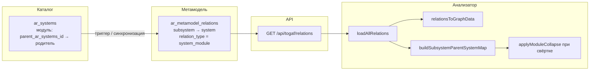

# Проекция связи `system_module` по внешнему ключу иерархии ИС

Обсуждение: как из физической связи «модуль ИС → родительская ИС» (`ar_systems.parent_ar_systems_id`) получается запись в метамодели (`ar_metamodel_relations`) с типом **`system_module`**, как это читает API и как строится граф в модуле «Анализ зависимостей».

Связанные материалы: [`demo-full-model-entities-matrix.md`](./demo-full-model-entities-matrix.md) (§3.1, тип `system_module`), [`issue-56-analyzer-module-integration-projections.md`](./issue-56-analyzer-module-integration-projections.md) (модульные проекции **интеграций** — другой источник, не путать с `system_module`).

---

## 1. Источник истины (уровень данных каталога)

| Сущность | Поле | Смысл |
|----------|------|--------|
| `archrep.ar_systems` | `parent_ar_systems_id` | FK на `ar_systems.id` родительской **корневой** ИС; у **модуля** заполнен, у **корня** дерева — `NULL`. |

Модуль и корень — **одна таблица** `ar_systems`; логический тип «модуль» определяется только наличием родителя (см. API: для строк с `parent_ar_systems_id != null` в ответ подмешивается тип отображения **`subsystem`**).

Ограничения целостности (нет циклов, не ссылаться на себя) задаются на уровне БД/триггеров в вашей среде; в документации каталога это сведено, например, в [`home-dashboard-catalog-metrics.md`](./home-dashboard-catalog-metrics.md).

---

## 2. Проекция в `ar_metamodel_relations` (уровень метамодели)

**Идея:** одна строка каталога-модуля с заполненным `parent_ar_systems_id` порождает **одну направленную** связь в графе метамодели с кодом типа **`system_module`**.

Целевая семантика строки в `ar_metamodel_relations` (как её **ожидает фронт** анализатора):

| Поле | Типичное значение |
|------|-------------------|
| `from_entity_type` | `subsystem` |
| `from_entity_id` | `id` **модуля** (дочерней строки `ar_systems`) |
| `to_entity_type` | `system` |
| `to_entity_id` | `id` **родителя** (= значение `parent_ar_systems_id`) |
| `relation_type` | `system_module` |
| `name` / `displayed_name` | Часто пусто или заполняется при синхронизации; подпись на рёбрах может браться из справочника типов связи (см. §4). |
| `reference_to_baserow` | Обычно `NULL` (не проекция из другой «базовой» строки потока, в отличие от `integration_flow_*`). |

**Жизненный цикл (алгоритм на уровне БД, концептуально):**

1. При **INSERT** строки в `ar_systems` с непустым `parent_ar_systems_id` (и корректной ссылкой на существующего родителя) — **вставить** соответствующую строку в `ar_metamodel_relations` с полями выше.
2. При **UPDATE** `parent_ar_systems_id` — **удалить** старую проекцию `system_module` для этой пары (или по ключу «модуль = from_entity_id») и **вставить** новую с актуальным `to_entity_id`.
3. При **UPDATE**, когда модуль становится корнем (`parent_ar_systems_id` стал `NULL`) — **удалить** проекцию `system_module` для этого `from_entity_id`.
4. При **DELETE** модуля — каскадно или триггером **удалить** строку в `ar_metamodel_relations`.

Конкретные имена функций/триггеров в вашей БД могут отличаться; в репозитории исторически ссылались на миграции вроде `archrep_issue32_system_module_relations.sql` (сейчас файл может отсутствовать в дереве — ориентируйтесь на фактические объекты в PostgreSQL: `\df+`, `\dS ar_systems`).

---

## 3. Справочники метамодели (без параметров `ar_settings_parameters` для кода типа)

Чтобы строки `ar_metamodel_relations` корректно обогащались именем типа связи в API:

- В **`ar_metamodel_entity_types`** должны существовать коды **`system`** и **`subsystem`** (и при необходимости **`system_child`** для отдельной визуализации — см. issue про анализатор).
- В **`ar_metamodel_relation_types`** должна быть строка с **`code = 'system_module'`** и согласованными **`from_entity_type_id` / `to_entity_type_id`** для пары сущностей, которая **совпадает** с полями `from_entity_type` / `to_entity_type` в `ar_metamodel_relations`.

Бэкенд при выборке связей делает `LEFT JOIN` к `ar_metamodel_relation_types` по **тройке** `(relation_type, from_entity_type_id, to_entity_type_id)`, выведенной из кодов в строке связи:

```485:494:backend/queries.js
  metamodel_relations_select: `
    SELECT r.id, r.from_entity_type, r.from_entity_id, r.to_entity_type, r.to_entity_id, r.relation_type, r.name, r.displayed_name, r.reference_to_baserow, r.description, r.payload, r.created_at, r.updated_at,
           rrt.name AS relation_type_name
    FROM archrep.ar_metamodel_relations r
    LEFT JOIN archrep.ar_metamodel_entity_types rfe ON rfe.code = r.from_entity_type
    LEFT JOIN archrep.ar_metamodel_entity_types rte ON rte.code = r.to_entity_type
    LEFT JOIN archrep.ar_metamodel_relation_types rrt
      ON rrt.code = r.relation_type
     AND rrt.from_entity_type_id = rfe.id
     AND rrt.to_entity_type_id = rte.id
```

Если JOIN не сходится (несогласованные коды в `ar_metamodel_relations` и справочнике), **`relation_type_name`** будет `NULL`, и подпись ребра уйдёт в fallback по полю `relation_type` (см. ниже).

**Важно:** для связи `system_module` в текущем коде клиента зафиксировано направление **`subsystem` → `system`**. Если в справочнике `ar_metamodel_relation_types` тип зарегистрирован как `system → subsystem`, JOIN к `rrt` может не найти строку — проверяйте согласованность с фактическими `from_entity_type` / `to_entity_type` в данных.

---

## 4. Параметры и шаблоны: что влияет на отображение

### 4.1 Подпись ребра на графе

Функция на клиенте (порядок приоритета):

```103:113:frontend-v3/src/api/graphApi.js
export function relationDisplayName(r) {
  if (!r) return ''
  const d = String(r.displayed_name ?? '').trim()
  if (d) return d
  const n = String(r.name ?? '').trim()
  if (n) return n
  const tn = String(r.relation_type_name ?? '').trim()
  if (tn) return tn
  return String(r.relation_type ?? '')
}
```

То есть для `system_module` используются **поля самой строки связи** и **`relation_type_name` с бэка** (из JOIN со справочником). **Отдельного** параметра в `ar_settings_parameters` вида `SYSTEM_MODULE_RELATION_CODE` в коде бэкенда для этой связи не предусмотрено (в отличие от кодов связей лидов: `SYSTEM_IT_LEAD_RELATION_CODE`, … — см. `DB/scripts/migrate_20260501120000_ar_employees_system_leads.sql`).

### 4.2 Подписи узлов `system` / `subsystem`

Имена узлов на графе приходят из загрузки сущностей (`/api/systems/...` и шаблоны отображения). На бэкенде для сущностей используются параметры вида **`DISP_SYSTEM_TEMPLATE`** и **`DISP_SUBSYSTEM_TEMPLATE`** (кэш настроек, см. `backend/displayName.js`). Это **не** часть записи `system_module`, но влияет на подписи концов ребра в UI.

### 4.3 Поведение при «свёртке модулей» в родительскую ИС

Для переназначения рёбер и скрытия узлов модулей используется карта родителя, построенная **только** по связям с `relation_type === 'system_module'`:

```188:202:frontend-v3/src/api/graphApi.js
export function buildSubsystemParentSystemMap(relations) {
  /** @type {Record<string, string>} */
  const map = {}
  for (const r of relations || []) {
    if (r.relation_type !== 'system_module') continue
    if (r.from_entity_type !== 'subsystem' || r.to_entity_type !== 'system') continue
    map[nodeId('subsystem', r.from_entity_id)] = nodeId('system', r.to_entity_id)
  }
  return map
}
```

Дополнительно на клиенте (конфиг по умолчанию в `frontend-v3/src/config/params.js`, может переопределяться через настройки приложения):

| Параметр / ключ конфига | Назначение |
|-------------------------|------------|
| `GRAPH_COLLAPSED_SYSTEM_ICON` | Иконка узла родительской ИС при свёрнутых модулях (issue #48). |
| `GRAPH_MAX_NODES`, `GRAPH_LAYOUT_DEF`, `GRAPH_ENTITY_ORDER`, … | Ограничения и раскладка графа; к самой проекции FK не относятся. |

---

## 5. Поток данных до графа (алгоритм end-to-end)



1. **БД:** изменение иерархии в `ar_systems` поддерживает согласованность строк в `ar_metamodel_relations` с типом `system_module`.
2. **API:** клиент запрашивает полный список связей метамодели (`loadAllRelations` → `togafApi.relations` → `metamodel_relations_select` с `relation_type_name`).
3. **Граф:** `relationsToGraphData` создаёт узлы по парам `(entity_type, entity_id)` и рёбра с подписью `relationDisplayName(r)`.
4. **Свёртка модулей:** по `system_module` строится `subsystem → system`; при включённой свёртке для выбранной родительской ИС вызывается `applyModuleCollapse`, рёбра модулей переназначаются на узел системы.

---

## 6. Отличие от проекций интеграционных потоков

| Аспект | `system_module` | `integration_flow_*` |
|--------|-----------------|----------------------|
| Источник | FK `ar_systems.parent_ar_systems_id` | Строки `ar_integration_flows` |
| Пересборка | События по `ar_systems` | `rebuild_integration_flow_metamodel_relations()` и/или триггеры |
| `reference_to_baserow` | Обычно пусто | Указывает на базовую строку потока |
| Параметры шаблона имени потока | Не используются | `DISP_INTEGRATION_FLOW_NAME` и др. (см. `displayName.js`, SQL проекций) |

---

## Критерии корректности в среде

- Для каждого модуля с непустым `parent_ar_systems_id` в `ar_metamodel_relations` есть ровно одна строка с `relation_type = 'system_module'` и направлением **`subsystem` → `system`**, как ожидает `buildSubsystemParentSystemMap`.
- В справочнике `ar_metamodel_relation_types` есть согласованная с данными запись для `system_module`, чтобы в API приходил `relation_type_name`.
- После смены родителя или отвязки модуля проекция обновляется или удаляется, чтобы граф не показывал устаревшие рёбра.
