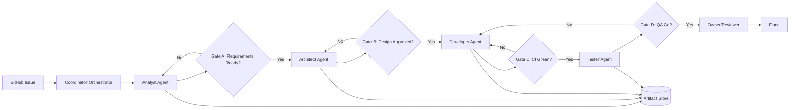

# Multi-Agent Full Development Cycle (C4-style)

## Статус

**Не внедрено в проекте (Not implemented yet).**  
Документ описывает целевую архитектуру процесса разработки, где роли реализуются отдельными агентами и передают задачи друг другу через формальные артефакты.

## Цель

Организовать stage-gated конвейер разработки:

1. Аналитик
2. Архитектор
3. Разработчик
4. Тестировщик
5. Решение владельца продукта (merge/release)

Ключевой принцип: переход на следующий этап возможен только после прохождения соответствующего gate.

---

## 1) Компоненты и функции

| Компонент | Функция |
|---|---|
| Task Source (GitHub Issues) | Единый источник постановки: проблема, scope, acceptance criteria. |
| Coordinator Orchestrator | Запускает роль-агентов по порядку, валидирует выход, маршрутизирует handoff. |
| State Tracker | Хранит статус этапа: `Backlog -> Analysis -> Architecture -> Dev -> QA -> Done`. |
| Analyst Agent | Уточняет требования, границы, edge-cases, формирует проверяемые критерии. |
| Gate A: Requirements Ready | Блокирует переход, пока анализ не завершён и не согласован. |
| Architect Agent | Готовит design, карту изменений, риски, rollback-подход. |
| Gate B: Design Approved | Блокирует разработку до утверждения архитектуры. |
| Developer Agent | Вносит изменения, делает branch/commit/push/PR, связывает код с AC. |
| Gate C: CI Green | Проверяет lint/test/build перед передачей в QA. |
| Tester Agent | Проводит функциональные и регрессионные проверки, готовит QA-отчёт. |
| Gate D: QA Go/No-Go | Разрешает выпуск только при явном решении Go. |
| Owner/Reviewer | Принимает финальное решение: merge/rework/reject. |
| Artifact Store (Issue/PR/docs) | Сохраняет артефакты передачи и решения по этапам. |
| Notification Layer | Уведомляет о прохождении/провале gates и завершении этапов. |
| Observability/Metrics | Метрики цикла: lead time, возвраты, причины провалов gates. |

---

## 2) Контракты передачи (handoff contracts)

### Analyst -> Architect (Analysis Packet)
- Problem statement и business goal
- Scope / out-of-scope
- Acceptance criteria (чек-лист, пригодный к тестированию)
- Edge-cases, assumptions, unresolved questions

### Architect -> Developer (Design Packet)
- Архитектурное решение и ключевые ADR-решения
- Impact map по модулям/API/DB
- Миграционный и rollback-подход
- Технические риски и ограничения

### Developer -> Tester (Implementation Packet)
- Ссылка на PR + список коммитов
- Трассировка: criterion -> code change
- Инструкция проверки/запуска
- Известные ограничения

### Tester -> Owner (QA Packet)
- Результаты проверок (functional + regression)
- Доказательства (логи/скриншоты/репорты)
- Дефекты с приоритетами
- Рекомендация Go/No-Go

---

## 3) Gates (правила перехода)

- **Gate A (Requirements Ready):** без завершённого анализа дизайн запрещён.
- **Gate B (Design Approved):** без утверждённого дизайна разработка запрещена.
- **Gate C (CI Green):** без зелёного CI передача в QA запрещена.
- **Gate D (QA Go/No-Go):** без QA-Go merge/release запрещён.

Если gate не пройден, задача возвращается на предыдущий ответственный этап, а не в начало процесса.

---

## 4) Основной поток (logical flow)

`Issue -> Coordinator -> Analyst -> Gate A -> Architect -> Gate B -> Developer -> Gate C -> Tester -> Gate D -> Owner`

---

## 5) Диаграмма процесса (Mermaid)

---

## 6) C4-style представление

### C1 — Context (границы системы)

**System:** Multi-Agent Delivery Orchestrator  
**Actors/External systems:**
- Product Owner / Team Lead (утверждения и финальные решения)
- GitHub (Issues/PR/CI)
- Repo + CI runner

**Назначение:** оркестрация ролей и контролируемых handoff между этапами delivery lifecycle.

### C2 — Container (контейнеры внутри системы)

1. **Coordinator Service**
   - Драйвит workflow, вызывает роль-агентов, применяет правила gates.
2. **Role Agents Runtime**
   - Набор агентов: Analyst, Architect, Developer, Tester.
3. **Workflow State Store**
   - Состояния этапов, решения gates, история возвратов.
4. **Artifact Store**
   - Хранилище артефактов этапов (docs/Issue comments/PR sections).
5. **Policy Engine**
   - Правила обязательных полей handoff, критерии прохождения gates.
6. **Notification Adapter**
   - Уведомления о переходах и блокировках.
7. **GitHub Adapter**
   - Интеграция с Issues/PR/CI statuses.

### C3 — Component (детализация Coordinator Service)

1. **Stage Router**
   - Определяет следующий этап и исполнителя.
2. **Gate Evaluator**
   - Проверяет входные критерии перехода между этапами.
3. **Contract Validator**
   - Валидирует обязательные поля handoff packet.
4. **Retry/Return Handler**
   - Возвращает задачу на корректирующий этап при провале gate.
5. **Audit Logger**
   - Фиксирует кто/когда/почему принял решение.
6. **Metrics Collector**
   - Считает DORA-like метрики и показатели rework.

---

## 7) Минимальные артефакты для запуска процесса

1. Issue template (постановка + acceptance criteria)
2. Architecture template (решения + impact + rollback)
3. Dev handoff template (criterion-to-code mapping)
4. QA report template (pass/fail + severity + Go/No-Go)
5. PR template (summary + test plan + gate checklist)

---

## 8) Критерии «процесс реально внедрён»

- Этапы и gates отражаются в статусах задачи.
- Нельзя перейти к следующему этапу без валидного handoff артефакта.
- Любой провал gate формирует возврат на конкретный предыдущий этап.
- Финальный merge/release выполняется только после QA Go и явного одобрения владельца.
