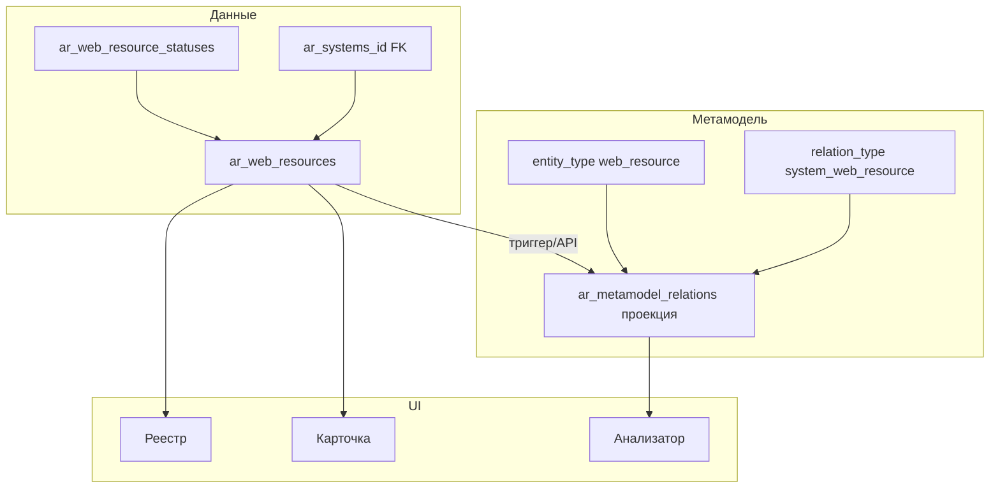

# Реестр веб-ресурсов — спецификация

Документ фиксирует согласованную модель данных, метамодель, проекции связей, UI и порядок внедрения реестра **веб-ресурсов** в ИСАР.

**Связанные материалы:** [adding-new-entity-type.md](./adding-new-entity-type.md), [demo-full-model-entities-matrix.md](./demo-full-model-entities-matrix.md) (§3.2 — словарь типов связей), [domain-registry-schema.md](./domain-registry-schema.md) (#67 — реестр доменов и FK «Домен»), [access-control-design.md](./access-control-design.md) (`web_resource:*`), [db-migrations-dual.mdc](../.cursor/rules/db-migrations-dual.mdc) (prod `DB/scripts/*.sql` + demo `DB/migrations/*.js`).

---

## 1. Назначение

Реестр учитывает публикуемые в сети Интернет веб-ресурсы Общества и их привязку к **информационной системе или модулю** (`ar_systems` — корневая ИС или дочерний модуль).

Каждая запись реестра:

- хранит атрибуты публикации (URL, категория, стенд, заявка, даты, статус);
- через **FK** `ar_systems_id` однозначно относится к одной ИС или модулю;
- автоматически порождает **проекцию** связи метамодели «**Опубликован**» (`system → web_resource` или `subsystem → web_resource`);
- участвует в **анализаторе зависимостей** с первого релиза.

**Исключено из модели (по решению):** атрибут «Техническая информация для публикации».

---

## 2. Согласованные решения

| № | Вопрос | Решение |
|---|--------|---------|
| 1 | Привязка к ИС | **ИС или модуль** (`ar_systems_id`); тип владельца: корневая ИС → `system_web_resource`, модуль → `subsystem_web_resource` |
| 2 | Категория и стенд | Справочники **`ar_web_resource_categories`**, **`ar_web_resource_stage_types`** (сиды: `code = name`) |
| 3 | Ссылки на магазины приложений | **Удалено** (поле `app_store_links` не используется) |
| 4 | Основание для публикации | **Строка** — номер заявки на публикацию |
| 5 | Код записи | **Автогенерация** с префиксом `WR-` (аналог `GAP-` для арх.долга) |
| 6 | Статус | **Обязателен**; отдельный **справочник статусов** |
| 7 | Анализатор зависимостей | Тип **`web_resource`** включается **сразу** (picker, граф, `GRAPH_ENTITY_ORDER` / иконки) |
| 8 | Привязка к домену (#67) | Nullable FK **`ar_domains_id`** → реестр доменов; проекция **«Размещен»** (`web_resource_domain`); валидация URL↔домен — **400** при несовпадении (см. [domain-registry-schema.md](./domain-registry-schema.md)) |

---

## 3. Справочник статусов веб-ресурса

**Таблица:** `archrep.ar_web_resource_statuses`

| Атрибут | Тип | Описание |
|---------|-----|----------|
| id | bigserial PK | Идентификатор |
| code | varchar UNIQUE | Код (латиница, для сидов и отчётов) |
| name | varchar NOT NULL | Наименование для UI |
| description | text NULL | Описание |

**Рекомендуемые начальные значения:**

| code | name | Назначение |
|------|------|------------|
| `draft` | Черновик | Запись создана, публикация не завершена / не подтверждена |
| `published` | Опубликован | Ресурс опубликован (основной рабочий статус) |
| `unpublished` | Снят с публикации | Ресурс снят с публикации, запись сохраняется в реестре |

Перечень уточняется при внедрении; CRUD справочника — в блоке **«Справочники»** (`ReferencesV2.vue`), по аналогии с `ar_gap_states` / `ar_business_service_statuses`.

---

## 3.1. Справочник категорий веб-ресурса

**Таблица:** `archrep.ar_web_resource_categories`

| code / name | Назначение |
|-------------|------------|
| `Web-app` | Веб-приложение |
| `Промо/лендинг` | Промо-страница или лендинг |
| `API` | Программный интерфейс |

CRUD: `/api/togaf/web-resource-categories`, вкладка «Категории веб-ресурсов» в справочниках.

---

## 3.2. Справочник типов стенда

**Таблица:** `archrep.ar_web_resource_stage_types`

| code / name | Назначение |
|-------------|------------|
| `prod` | Промышленный стенд |
| `test/stage` | Тестовый или предпромышленный стенд |

CRUD: `/api/togaf/web-resource-stage-types`, вкладка «Типы стенда веб-ресурсов» в справочниках.

---

## 4. Основная таблица реестра

**Таблица:** `archrep.ar_web_resources`

| Атрибут | Тип | Поле в ТЗ | Описание |
|---------|-----|-----------|----------|
| id | bigserial PK | — | Идентификатор |
| code | varchar UNIQUE NOT NULL | — | Код `WR-{n}`; автогенерация при INSERT |
| short_name | varchar NOT NULL | Краткое наименование | Отображаемое краткое имя |
| purpose | text NULL | Назначение | Назначение веб-ресурса |
| publication_url | varchar NULL | Адрес публикации (URL) | Публичный URL; валидация формата на API |
| ar_systems_id | int8 NOT NULL FK | ИС / модуль | → `archrep.ar_systems(id)`; корневая ИС или модуль |
| ar_web_resource_categories_id | int8 NOT NULL FK | Категория | → `archrep.ar_web_resource_categories(id)` |
| ar_web_resource_stage_types_id | int8 NOT NULL FK | Тип стенда | → `archrep.ar_web_resource_stage_types(id)` |
| publication_request_number | varchar NULL | Основание (номер заявки) | Номер заявки на публикацию |
| publication_date | date NULL | Дата публикации | Фактическая или плановая дата публикации |
| ar_web_resource_statuses_id | int8 NOT NULL FK | Статус | → `archrep.ar_web_resource_statuses(id)` |
| ar_domains_id | int8 NULL FK | Домен (#67) | → `archrep.ar_domains(id)`; проекция «Размещен» |
| created_at | timestamptz | — | Аудит |
| updated_at | timestamptz | — | Аудит |

**Внешние ключи:**

- `ar_systems_id` → `archrep.ar_systems(id)` — рекомендуется `ON DELETE RESTRICT` (нельзя удалить ИС, пока есть веб-ресурсы) или `SET NULL` + запрет NULL на уровне приложения; **предпочтение: RESTRICT**.
- `ar_web_resource_statuses_id` → `archrep.ar_web_resource_statuses(id)` — `ON DELETE RESTRICT`.
- `ar_domains_id` → `archrep.ar_domains(id)` — `ON DELETE SET NULL` (см. [domain-registry-schema.md](./domain-registry-schema.md)).

**Индексы:** `code` (unique), `ar_systems_id`, `ar_web_resource_statuses_id`, `ar_domains_id`, `publication_date`, при необходимости GIN/trgm по `short_name` для поиска в реестре.

**Наименование ИС в таблице реестра:** не дублируется текстом; в списке и карточке — `display_name` связанной системы через JOIN / обогащение API.

---

## 5. Автогенерация кода `WR-…`

По аналогии с реестром арх.долга (`GAP_CODE_PREFIX`, последовательность `ar_gaps_code_seq`):

| Элемент | Предложение |
|---------|-------------|
| Последовательность | `archrep.ar_web_resources_code_seq` |
| Параметр | `WR_CODE_PREFIX` в `ar_settings_parameters` (значение по умолчанию `WR-`) |
| INSERT | `code = prefix \|\| nextval('ar_web_resources_code_seq')::text` → `WR-1`, `WR-2`, … |
| Сид параметра | `DB/scripts/seed_settings_parameters_from_candidates.sql` + миграция для существующих БД |

Шаблон отображаемого имени: **`DISP_WEB_RESOURCE_TEMPLATE`** (например `{short_name}` или `{code} — {short_name}`), см. `backend/displayName.js` и [display-name-templates-spec.md](./display-name-templates-spec.md).

---

## 6. Метамодель

### 6.1. Тип сущности

**`ar_metamodel_entity_types`:**

| code | name | table_name |
|------|------|------------|
| `web_resource` | Веб-ресурс | `ar_web_resources` |

### 6.2. Тип связи «Опубликован»

**`ar_metamodel_relation_types`:**

| code | name | description | From → To |
|------|------|-------------|-----------|
| `system_web_resource` | Опубликован | ИС опубликовала веб-ресурс в сети Интернет | `system → web_resource` |
| `subsystem_web_resource` | Опубликован | Модуль ИС опубликовал веб-ресурс в сети Интернет | `subsystem → web_resource` |

Код связи в формате матрицы demo: `<сущность_от>_<сущность_к>`.

Связь **не создаётся вручную** в обход карточки веб-ресурса (см. §7).

### 6.3. Тип связи «Размещен» (домен, #67)

| code | name | description | From → To |
|------|------|-------------|-----------|
| `web_resource_domain` | Размещен | Веб-ресурс размещён на домене | `web_resource → domain` |

Источник правды — `ar_web_resources.ar_domains_id`. Детали проекции, парсинга URL и разового наполнения — [domain-registry-schema.md](./domain-registry-schema.md) (§6–9).

---

## 7. Проекция связи по FK (ИС / модуль)

**Источник правды:** колонка `ar_web_resources.ar_systems_id`.

**Целевая строка в `ar_metamodel_relations`:**

| Поле | Значение |
|------|----------|
| from_entity_type | `system` или `subsystem` (по `parent_ar_systems_id` в `ar_systems`) |
| from_entity_id | `ar_systems_id` |
| to_entity_type | `web_resource` |
| to_entity_id | `ar_web_resources.id` |
| relation_type | `system_web_resource` или `subsystem_web_resource` |
| name | NULL или копия `short_name` (опционально) |
| description | NULL |
| payload | опционально `{"projection":"fk","source":"ar_web_resources.ar_systems_id"}` |

**Правила синхронизации:**

1. **INSERT** веб-ресурса → `INSERT` проекции (если FK задан).
2. **UPDATE** `ar_systems_id` → удалить старую проекцию для этой записи + `INSERT` с новой парой (или `UPDATE` from_entity_id).
3. **DELETE** веб-ресурса → удалить проекции `system_web_resource` и `subsystem_web_resource` для этой записи.
4. **Уникальность:** не более одной строки проекции на пару `(relation_type, from_entity_id, to_entity_id)` для данного веб-ресурса.
5. **Backfill** при миграции: для всех существующих строк `ar_web_resources` с непустым `ar_systems_id`.

**Реализация (на выбор, как у других FK-проекций в §3.2 матрицы):**

- триггер(ы) на `ar_web_resources` после INSERT/UPDATE/DELETE; и/или
- вызов модуля проекций из API после сохранения карточки.

**UI (первая версия):** вкладка «Связи» на карточке **не делается**; привязка к ИС — только поле «Информационная система» на форме. Проекция обновляется автоматически.

---

## 8. Backend

### 8.1. API (предложение)

| Метод | Путь | Назначение |
|-------|------|------------|
| GET | `/api/togaf/web-resources` | Список (поиск, пагинация, JOIN системы и статуса) |
| GET | `/api/togaf/web-resources/:id` | Карточка |
| POST | `/api/togaf/web-resources` | Создание (автокод, проекция) |
| PUT | `/api/togaf/web-resources/:id` | Обновление (пересборка проекции при смене ИС) |
| DELETE | `/api/togaf/web-resources/:id` | Удаление (+ удаление проекции) |
| GET/POST/PUT/DELETE | `/api/togaf/web-resource-statuses` | CRUD справочника статусов |

**Валидация:**

- `publication_url` — непустой URL при статусе `published` (опционально ужесточить на этапе реализации);
- `ar_systems_id` — существующая ИС или модуль (`ar_systems`);
- если заданы и `publication_url`, и `ar_domains_id` — извлечённый из URL домен должен совпадать с `ar_domains.name`, иначе **400** ([domain-registry-schema.md](./domain-registry-schema.md) §6.2);
- запрет прямого POST/PUT в `ar_metamodel_relations` с `relation_type` проекций WR (`system_web_resource` / `subsystem_web_resource` / `web_resource_domain`) без изменения соответствующего FK (ответ 400 с пояснением).

### 8.2. Файлы

- `backend/queries.js` — SQL;
- `backend/index.js` — маршруты, `DISPLAY_NAME_PATHS`, вызов синхронизации проекции;
- `backend/displayName.js` — `DISP_WEB_RESOURCE_TEMPLATE`, `ENTITY_TO_TEMPLATE`.

**Права доступа (RBAC, #66):** `web_resource:read|write|delete|export` — см. [access-control-design.md](./access-control-design.md). Пункт меню: **«Веб-ресурсы»** (`/web-resources`).

---

## 9. Frontend (Vue 3)

### 9.1. Реестр (табличная форма)

**Экран:** `WebResourcesList.vue` (по образцу `GapsList.vue`).

**Колонки по умолчанию:**

| Колонка | Источник |
|---------|----------|
| Код | `code` |
| Краткое наименование | `short_name` |
| Назначение | `purpose` (сокращение в таблице) |
| URL | `publication_url` |
| Категория | `category_name` |
| Стенд | `stage_type_name` |
| ИС / модуль | `system_display_name` (из API) |
| Домен | `domain_name` (из `ar_domains`, #67) |
| Номер заявки | `publication_request_number` |
| Дата публикации | `publication_date` |
| Статус | имя из справочника |

Поиск по всем полям, сортировка, «Вид», экспорт в Excel.

### 9.2. Форма редактирования

**Экран:** `WebResourceForm.vue`.

**Одна форма (без вкладки «Связи»):** все атрибуты §4; выбор **ИС или модуля** (`getSystems()` без `exclude_modules`); категория и стенд — select из справочников; статус — select из `ar_web_resource_statuses`; **Домен** — select из реестра доменов (`ar_domains_id`, #67).

**Маршруты:** `/web-resources`, `/web-resources/new`, `/web-resources/:id/edit` в `router/index.js`; пункт в `LayoutV3.vue`.

### 9.3. Анализатор зависимостей

С первого релиза (согласовано):

| Компонент | Действие |
|-----------|----------|
| `entityTypeConfig.js` | `web_resource`: label, icon (например `Globe`), listLabel |
| `graphApi.js` | `listFetchers.web_resource`, `entityFetchers.web_resource` |
| `GRAPH_ENTITY_ORDER` | Добавить `web_resource` в нужную позицию |
| `GRAPH_ENTITY_ICONS` | Дефолт иконки/подписи в сидах и `PUBLIC_CONFIG_DEFAULTS` |
| `AnalyticsView.vue` | Без спецфильтров (в отличие от system/subsystem) |

На графе узел появляется при инцидентных связях; типичное ребро от корневой ИС — **«Опубликован»** (проекция).

---

## 10. Миграции и demo

**Двойной контур** (обязательно):

1. **Prod / ручной SQL:** `DB/scripts/migrate_YYYYMMDD_web_resources.sql`  
   — таблицы, последовательность, сиды статусов, `entity_types`, `relation_types`, функция/триггер проекции, backfill, `WR_CODE_PREFIX`, `DISP_WEB_RESOURCE_TEMPLATE`.

2. **Demo deploy:** `DB/migrations/YYYYMMDD_web_resources.js` — тот же смысл для автоматического наката на demo.

**Обновить документацию матрицы:** строка в §1 `demo-full-model-entities-matrix.md` (сущность `web_resource`), строка в §3.2 (`system_web_resource`).

**Demo-данные:** 3–5 веб-ресурсов на 2–3 корневые ИС, статусы `draft` / `published`.

---

## 11. Порядок внедрения

1. DDL: `ar_web_resource_statuses`, `ar_web_resources`, последовательность кода, сиды статусов.
2. Метамодель: `web_resource`, `system_web_resource`.
3. Проекция: функция синхронизации + триггер/API + backfill.
4. Параметры: `WR_CODE_PREFIX`, `DISP_WEB_RESOURCE_TEMPLATE`; правки `displayName.js`.
5. Backend: CRUD реестра и справочника статусов.
6. Frontend: список, форма, меню (без RBAC и без вкладки «Связи»).
7. Анализатор: fetchers, конфиг графа, порядок типов.
8. Demo seed + обновление матрицы сущностей/связей.

---

## 12. Вне scope первой версии

- Отдельный реестр **заявок на публикацию** (остаётся строка `publication_request_number`).
- Атрибут «Техническая информация для публикации».
- Вкладка «Связи» на карточке веб-ресурса.
- Контроль срока доменов / email — [job-runner-design.md](./job-runner-design.md) (не #67).

---

## 13. Краткая сводка полей ТЗ → модель

| Требование | Реализация |
|------------|------------|
| Краткое наименование | `short_name` |
| Назначение | `purpose` |
| URL | `publication_url` |
| Категория | `ar_web_resource_categories_id` + справочник |
| Стенд | `ar_web_resource_stage_types_id` + справочник |
| ИС / модуль | `ar_systems_id` → проекция «Опубликован» |
| Домен (#67) | `ar_domains_id` → проекция «Размещен» (`web_resource_domain`) |
| Номер заявки | `publication_request_number` |
| Дата публикации | `publication_date` |
| Статус | `ar_web_resource_statuses_id` + справочник |
| Код записи | `WR-*` автогенерация |
| Связь system/subsystem–web_resource | `system_web_resource` / `subsystem_web_resource`, автопроекция |
| Связь web_resource–domain | `web_resource_domain`, автопроекция по FK |
